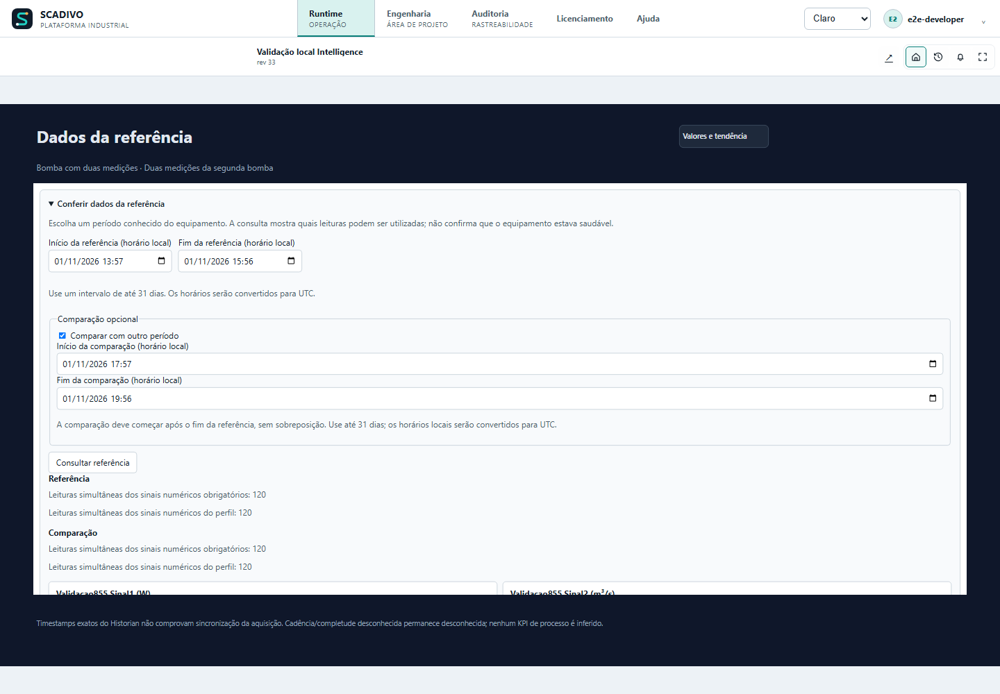
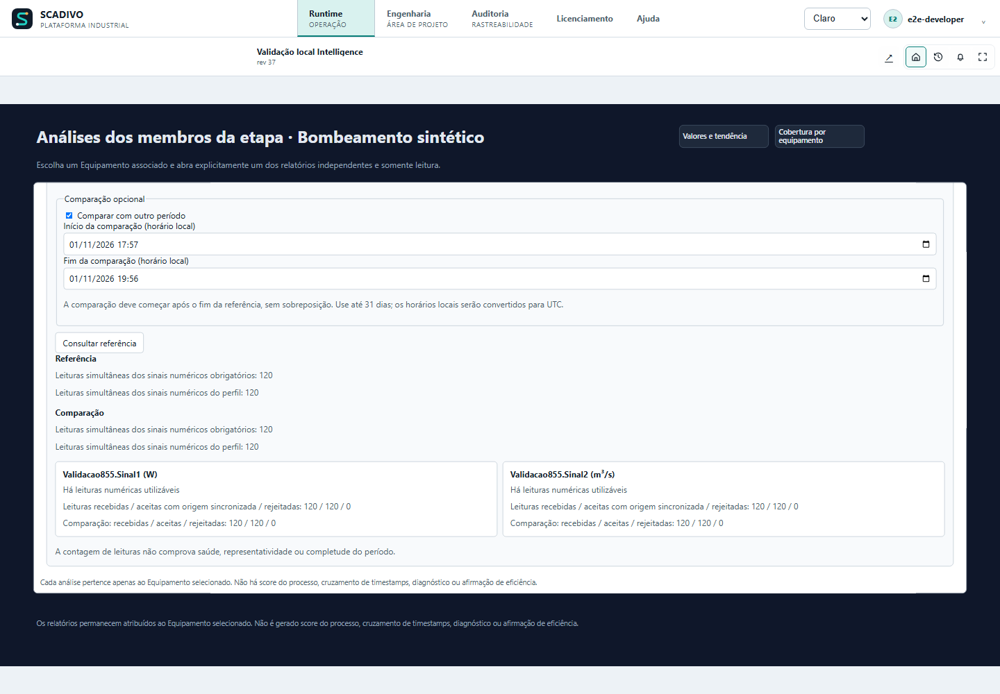
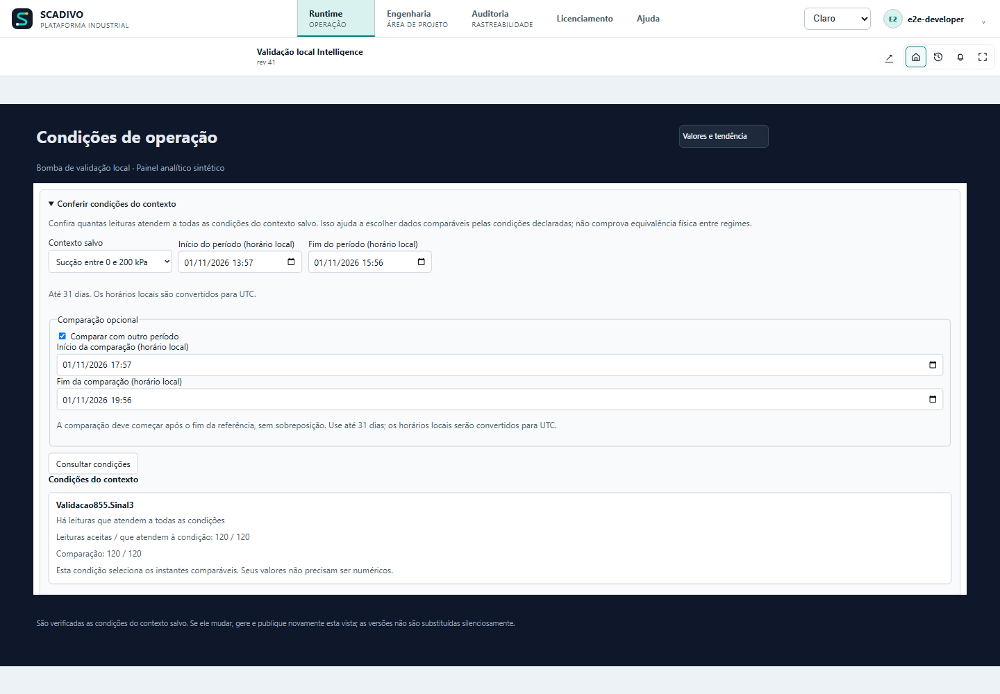
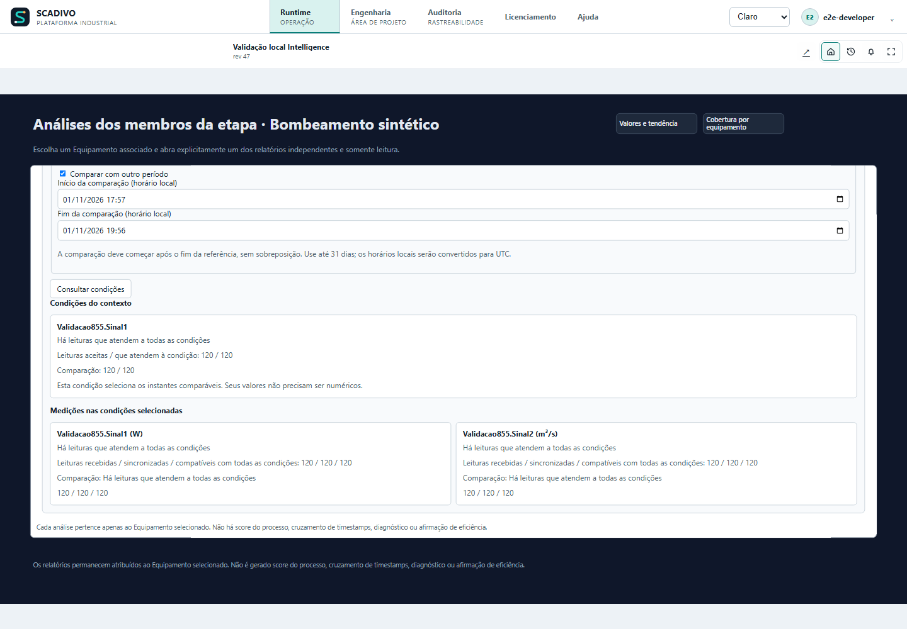
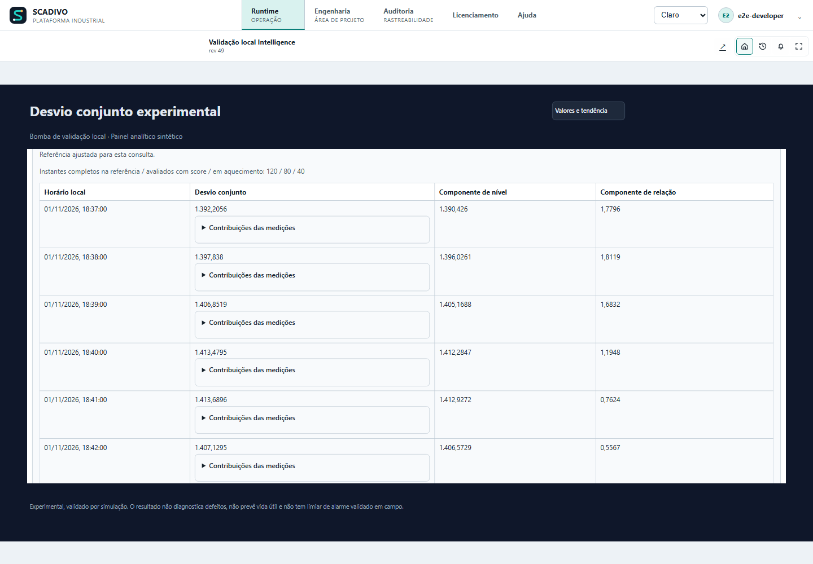

# Asset and Process Intelligence

This chapter describes the workflows available today. Intelligence is optional: the license enables the feature, but you configure the Equipment, profiles, and stages you intend to analyze. You do not need to apply analyses to the entire plant.

**Contextual Help:** `/help?topic=intelligence.overview`.

## Start with one small question

Imagine Pump 01. SCADIVO already receives current and speed, and you want to investigate whether current changed under similar operating conditions. Start with that question instead of configuring the whole plant. A comparison can guide investigation; it does not by itself establish physical efficiency or a defect.

Editor names represent parts of this task:

| Name | Meaning in this example |
| --- | --- |
| TAG | The variable providing current or speed. |
| Measurement profile | The sheet gathering chosen signals and each signal’s meaning. |
| Assignment | The connection between that sheet and Pump 01 registered as Equipment. |
| Operating context | The condition under which data should be compared, such as a defined operating range. |
| Process stage | An organized group of assignments, such as pumping equipment. It does not program starts. |
| Coverage | The query showing which usable data exists in the period. |

Follow this path and use the sections below for detail:

1. Check existing TAGs, their units and recorded data for the period. Do not invent missing sensors.
2. Build the profile and assign it to Pump 01. Pickers handle internal IDs.
3. Save configuration, choose where to use Intelligence, publish/activate the revision and explicitly enable the resource for analysis. License, configuration and authorized execution are separate conditions.
4. Query coverage first. Then choose only analyses whose requirements your signals meet. An unavailable result needs investigation; do not read it as zero.
5. For an operator view, generate a screen, review it in the normal editor and follow publication/activation. It opens in Runtime and queries require an explicit request; generation does not query data or automatically put the screen into operation.

You can start with one equipment. Contexts and stages are useful when they serve the question. Time, signal-role and limit details follow for lookup during configuration.

## 1. Start with Equipment and TAGs

Choose registered Equipment and useful measurement TAGs, such as current, voltage, pressure, flow or temperature. For each TAG, check value type and unit. Quality describes the reading’s condition; timestamp is its source time. Historian is recorded history, which needs data for the chosen period. Include a signal for the question it helps answer, not merely because it exists.

To edit, your account needs `EngineeringModify` and `AssetProcessIntelligenceManage`. The latter must be explicitly granted for all resources or for the equipment/location you will configure. Also check the Intelligence license. The account’s role name does not replace effective permission.

## 2. Create a measurement profile and assignment

1. Open Engineering > Asset Intelligence and create a Measurement profile. Give it a name that helps identify the group, such as “Transfer pump”.
2. Add the TAGs that describe the Equipment. For each TAG, explain what it measures, mark whether the analysis needs it, and complete the requested measurement details. Check the unit and actual TAG reference.
3. Save the configuration to Working.
4. In assignments, choose the existing Equipment and profile. One piece of Equipment can use more than one profile.
5. Review missing and duplicate references before saving and following the normal project lifecycle.

The profile organizes signal references and their meaning. The system creates its internal keys for you; you do not need to invent IDs or codes. The profile does not create TAGs, enable Historian capture by itself, or prove that instruments are calibrated.

## 3. Configure operating context

Higher current may be expected when speed or load rises. An operating context states conditions, such as pump running and speed within a defined range, to select comparable evidence. It does not automatically learn operating mode or turn correlation into diagnosis. Choose limits using Equipment knowledge.

Choose the equipment assignment and give the context a name explaining the condition, such as “Pump running at normal flow”. Add at least one condition using a TAG from the assigned profile. The system creates the context’s internal key.

For numbers, the range includes minimum and maximum in the TAG’s current unit. For booleans, choose True or False. For String or Enum, use the exact value, including case when applicable.

Every condition must match readings with exactly the same source UTC time. Readings merely close in time are not enough. If another edit changes the context, refresh the screen and review its conditions before saving.

## 4. Organize process stages

Use **Ordered process stages** to build the sequence you want to monitor. Give each stage a readable name, add Equipment/profile assignments and set their order. The system creates each stage’s internal key. A stage organizes members but does not itself infer causality, balance, or an aggregate process KPI.

Save the configuration to Working. Runtime data and analyses remain subject to the Active revision and current authorization.

For a stage, the same generator offers Member coverage and Member analyses. The list shows what is configured for each member. Use Configure this equipment to choose missing rules and signals, then return to the generator. Deviation does not need to be configured for every member to generate performance for the others. Selected views are linked, editable Screens. In Runtime, choose the equipment and analysis, set the period and query. Each result still belongs only to the selected equipment.

To check a reference in Runtime, choose an equipment profile in the generator and select Check reference data. This adds a separate Screen; it does not require performance or deviation configuration. Apply the set, save, publish and activate. In live Runtime, open Reference data, choose a known period and select Query reference. You will see received, accepted and rejected readings for each signal and how many could be used together. To compare another period, select Compare with another period and enter a later, non-overlapping interval. A high count does not prove the equipment was healthy. Changing the periods clears the result. The editor and historical playback do not execute this query.

To check reference data for stage equipment, choose the stage in the generator and select Reference data per equipment. Performance or deviation configuration is not required. This uses the same stage analyses Screen, keeping the set to at most three Screens. In Runtime, open Member analyses, choose the equipment and select Reference data. Enter the periods and query. Choosing another equipment closes the previous report, cancels a pending query and clears its result; no query runs automatically for the new equipment.

To bring operating conditions into Runtime, first save a context in the equipment assignment. In the generator, choose that profile and select Operating conditions. This adds a separate Screen and works without configured performance or deviation. Apply the set, save, publish and activate. In live Runtime, open Operating conditions, choose Saved context by name, enter the period start and end, and select Query conditions. To compare, use a later, non-overlapping period. The result shows how many readings meet each condition and how many meet all conditions together. For example, a pressure condition from 0 to 200 kPa may select readings that a range from 0 to 50 kPa excludes. Zero matching readings does not mean healthy equipment: it means the period provides no data under the selected conditions. Changing the context or periods clears the previous result. If the context changes in Engineering, generate and publish the view again; it does not silently assume a new version. The editor and historical playback do not execute the query.

To query conditions for stage equipment, choose the stage in the generator and select Operating conditions per equipment. At least one stage assignment must have a saved context; performance or deviation configuration is not required. Conditions use the same analyses Screen, keeping the set to at most three Screens. In Runtime, open Member analyses, choose the equipment, select Operating conditions and choose Saved context by name. Enter the periods and query. Only contexts belonging to that equipment appear. If no context is included for it, the page explains what is missing and keeps its other analyses available. Changing equipment or analysis closes the previous report, cancels a pending read and clears the result. No query starts automatically. If you change a context in Engineering, generate and publish the view again to use its new version.

To view joint deviation in Runtime, choose an equipment profile in the generator and select Experimental joint deviation. You need a saved context and at least two distinct numeric measurements outside its conditions. This adds a separate Screen without requiring performance or contextual deviation. Apply the set, save, publish and activate.

In live Runtime, open Joint deviation (experimental), choose Saved context and select two to eight measurements by name. Enter the actual interval between readings in seconds: for example, 60 for one reading per minute. Choose non-overlapping reference and evaluation periods, then select Calculate joint deviation. Opening the Screen does not query.

First check how many complete timestamps support the reference, how many produced a score and how many were warming up. Insufficient data does not mean normal operation: review the context, periods and readings. In the results, open Measurement contributions to investigate which measurements varied. The score describes deviation from the reference without a physical unit; a higher number does not confirm a fault.

This analysis is experimental, validated by simulation, without remaining-life prediction or a field-validated alarm threshold.

Changing context, measurements, cadence or periods clears the result. The editor and historical playback do not calculate. If the context changes in Engineering, generate and publish the view again. Inclusion in the stage equipment selector is still pending; use the profile Screen.

## 5. Request analyses

Select an assigned Equipment and choose an available analysis, such as profile coverage, performance, or contextual deviation. Set the time range and explicitly request the query. Contextual deviation requires configured operating conditions and sufficient temporal evidence. Analysis is read-only; it does not change a TAG, command Equipment, or replace Alarms.

Interpret results together with coverage, quality, timestamps, and each signal's limitations. Missing values, poor quality, unavailable history, or temporal misalignment do not mean zero, normal operation, or a confirmed fault. Current analyses are not a maintenance diagnosis or proof of physical efficiency. For stage members, inspect one Equipment at a time; do not combine independent results as a process score.

**Contextual Help:** `/help?topic=intelligence.process-stage-member-insights`.

## 6. Generate Screen drafts

Save pending Intelligence configuration changes first. At the top of the page, find **Create a Runtime dashboard** and choose an equipment profile or process stage under **Dashboard content**. The list uses names already in the project; you do not type IDs. The basic generator needs at least one resolved numeric TAG. If no source can be selected, complete the profile, assignment or stage, and check the license and permissions.

Select **Generate dashboard draft**. SCADIVO opens a normal editable Screen in the canonical editor, with value cards, a trend and coverage arranged from existing TAGs. This is a draft: it does not query live values or Historian, invent KPIs or publish the Screen.

In the editor, review names, units, dimensions, bindings and readability. Use **Preview** and **Apply to Workspace**; then save, publish and activate the project revision, and configure/check Runtime navigation. Only then can operators open the Screen. Specialized guided actions appear with their related analyses and may require additional rules or ranges.

When the generator creates linked Screens, Preview and Apply to Workspace include the whole set to preserve navigation destinations. Review the set before applying.

## 7. Common problems

### Choose dashboard objects and analyses

After choosing the source, open each measurement under **Measurement objects**. Choose a numeric value, semicircular dial, ring, horizontal bar, vertical ruler, bands or value with a target. Presentation does not change the TAG or calculation. Object themes are light, dark or high contrast.

Scaled objects require actual minimum and maximum limits in the TAG unit. A valid configured TAG scale is prefilled. Otherwise enter the real limits. Bands require two ordered boundaries inside the scale; a target must be within its limits. Incomplete or invalid ranges block generation. Use Numeric value when no suitable scale is known.

Under **Dashboard analyses**, performance and contextual deviation become available when their assignment selections are complete. Use **Configure assignment analyses** to reach the existing controls. Each analysis can be included independently. Multiple generated views receive navigation buttons linking their Screens. An unavailable analysis does not block the other views; read its reason before changing a signal's meaning.

Generated dashboards use their own dark background to retain contrast under either application theme. You can change it under Background in the Screen editor; check text and value colors when choosing another background.

- **Resource blocked:** check the license, `EngineeringModify`, `AssetProcessIntelligenceManage`, and scope.
- **Incomplete profile/assignment:** check Equipment, profile, TAGs, and required qualifiers.
- **No coverage/history:** confirm that the TAG received useful samples with quality and timestamps and that capture existed during the period. Historian does not backfill data.
- **No context match:** review the conditions, unit, range and whether readings have the same source time.
- **Draft unavailable:** complete the selections required by that Screen type and use the normal editor to refine the result.
- **Result differs after editing:** save the correct configuration, check the Active revision, and explicitly run a new query.

**Related Help:** `/help?topic=historian.overview`, `/help?topic=tags.quality`, `/help?topic=tags.timestamps`, `/help?topic=screens.overview`, `/help?topic=engineering.lifecycle`.

## Check the data before interpreting

In Engineering > Asset intelligence, locate the equipment assignment. Under Check reference data, choose the start and end of a known period and select Query reference. Times are local and converted to UTC. Each period supports up to 31 days. Accepted readings have the required source evidence; rejections explain why other readings were excluded. Counts do not prove that the equipment was healthy.

Under Check context conditions, select a saved context by name and query the period. SCADIVO uses its saved version automatically. Results show how many readings meet all conditions at the same source time. Zero matching readings may mean unmet conditions or insufficient data; read the explanation. Publish changes and activate the equipment before querying.

## Use experimental joint deviation

Open Experimental joint deviation in the assignment. Choose the saved context and two to eight numeric measurements; measurements defining context conditions are excluded from target choices. Enter the actual acquisition interval in seconds, from 1 to 86,400. Do not invent this value: it describes the expected reading frequency. Choose a reference and a later, non-overlapping evaluation period, then select Calculate joint deviation.

Results show scored timestamps and warmup counts. Deviation combines changes in level and relationships between signals. Expand Measurement contributions to investigate each signal's contribution. These numbers have no physical unit and do not diagnose causes, faults or remaining life. This experimental function is validated by simulation only and has no field-validated alarm threshold.

Use Cancel query to stop. Changing periods, context, signals or cadence discards previous results; query again. If the reference cannot be fitted, check data, quality, synchronization, context and signal variation before widening periods.

## Understand counts and conditions

Analyses are queried on demand: editing profiles or activating a scope does not start continuous analysis. In reference evidence, read the reasons beside Unavailable. A required text, enum or Boolean signal is outside the required numeric cohort; numeric profile counts are shown separately. A zero count for an unqueried type does not prove there is no history.

In context queries, start with Context conditions: accepted readings and how many matched each condition. A textual operating mode can still select valid timestamps for current or flow. Then review measurements under the selected conditions. These counts do not prove health or efficiency.

## Compare two periods and cancel queries

In reference and context-condition queries, select Compare with another period to inspect evidence in two windows. Enter comparison start and end. Each window supports up to 31 days, and comparison must start strictly after the reference ends: do not use the same instant for both boundaries. Querying remains unavailable while fields are empty, dates are reversed or periods overlap.

Query and read each period's counts. Comparing counts is not, by itself, an efficiency indicator. Disabling comparison or changing any boundary clears the previous result. During reading, use Cancel query: a delayed response must not reappear. To query again, review the parameters and select the query button.

<!-- installed-system-guides -->

## Intelligence: enable, pause and resolve blocks

Choose which equipment to analyze, prepare its configuration and activate use. Having the license does not automatically start analyses.

### Follow the full sequence

Start with one piece of equipment, such as Pump 01. Open Engineering > Asset Intelligence. You will gather its variables, identify which equipment they belong to and choose where to use analysis.

The profile lists signals and their meanings. An assignment connects that profile to registered Equipment. Configure contexts and stages only when they fit your question. Then save, publish and activate the project revision.

One separate decision remains: explicitly activate the selected resource to allow analyses. Creating the profile, checking a box or having the license does not do that for you.

### Permissions and resource selection

Your account needs permission to edit Engineering and manage Intelligence for the selected equipment or locations. Security shows these as EngineeringModify and AssetProcessIntelligenceManage. The latter needs an explicit grant, global or scoped to the resource. A role name such as Developer or SystemAdmin does not by itself establish that grant.

Queries also require TrendUse and the Intelligence license. If a control is blocked, check the session’s effective capabilities there. Choose resources through the pickers; there is no need to memorize or invent IDs.

### Activate only where useful

1. Under Eligible scopes, select only the equipment or locations you want to analyze. Here, scope means that selection of resources.
2. Save the scopes and prepared configuration.
3. Publish and activate the project revision. Resolve pending changes before allowing execution.
4. On the resource row, use Activate and check that its execution permit is armed, meaning execution is allowed for that resource.
5. Open the assignment query, choose a period and request analysis. Activation allows a query; it does not automatically run one.
6. Use Pause to stop analyses. Pending work is cancelled, while TAGs and history remain. Pause a resource before removing it from the selection.

### Configured active does not mean armed

If a permission was revoked, a resource can remain marked Active in configuration while execution is blocked. These are different facts: what was configured and what is authorized now.

Restoring the grant does not silently restart work. Check status and use Activate again, including after restart when requested by the screen. This requires an explicit decision by the responsible person. Check this condition before investigating missing data in the recorded history, called Historian.

### Example: start small

For Pump 01, start with current and speed if those measurements exist. Choose analyses that accept them. When more measurements become available, you can expand the profile and use other compatible analyses.

Keep unused resources paused. Do not invent a missing vibration signal. Selection limits what is allowed to run, but does not guarantee fixed processor or memory usage.

[Open this guide in installed Help](/help?topic=intelligence.activation)

## Intelligence: signal meaning and units

Describe what was measured, not just the TAG name.

### Why a name is not enough

Before calculating, specify what each variable measures. A TAG named Power might be active power, apparent power or a calculation; Pressure might measure suction, discharge or their difference. Its name alone does not identify the right formula.

In the profile, choose the required semantic role: the option that identifies the signal’s meaning for analysis. Then fill in its displayed qualifiers, the details that make that choice precise. Legacy role text remains a description; it does not replace this selection.

### Fields and choices

Use this table when a profile field is unclear. Pickers show options accepted by the current catalog. Choose what matches the instrument and process, even if another option would unlock a calculation.

| Field | Purpose and how to fill it | Example | Bounds |
| --- | --- | --- | --- |
| Required | Marks signals whose absence compromises requested coverage. Do not mark essential signals optional just to obtain a result. | Current needed for comparison |  |
| Semantic role | Choose what the signal represents in the calculation: its quantity and function in the machine. Analysis uses that controlled option; it does not guess from the TAG name. | Active input power, if measured |  |
| Current basis | Specify the current basis supplied by the instrument and accepted by the role, such as RMS when appropriate. If its label only says current, confirm the measurement before choosing. | Select the documented instrument option |  |
| Signal kind | Distinguishes measurement, reference and the role-required function. A setpoint does not prove a measured value. | Actual measurement when required |  |
| Pressure reference | Specify which pressure was measured. Outlet minus inlet pressure differs from discharge pressure alone; choose the basis required by the role and confirmed by the instrument. | Measured outlet − inlet differential |  |
| Flow direction | Identifies transfer direction; the opposite direction may invalidate a rule. | Pump to process, when applicable |  |
| Frequency reference | Identifies frequency meaning per catalog; distinguish electrical reference from physical speed. | Check instrument source |  |
| TAG and unit | Select the actual TAG and check its controlled engineering unit. A profile label change does not convert data. Some calculations require specific catalog units/versions. | kW for power when it matches actual data |  |

### Example: do not confuse a proxy with efficiency

Suppose pump current rises while speed stays the same. That can guide an investigation, but current alone does not calculate the motor’s physical efficiency. It is a substitute indicator, also called a proxy.

Other rules may use electrical input power, flow and pressure difference. They become available only when signals meet the required roles, units and alignment. If a measurement or necessary detail is missing, read the reason for unavailability; do not enter fictional values to unlock the rule.

[Open this guide in installed Help](/help?topic=intelligence.semantics)

## Intelligence: query results and build dashboards

Start by checking data for the period. Then choose a calculation and, if needed, generate a screen for Runtime queries.

### Start with coverage

Coverage answers the first question: is there usable data for this analysis? With the assignment saved and execution authorized, open the profile’s coverage query. Choose start and end and request the query.

The form shows local times; the query also identifies its UTC window, the common time reference used to compare data. End must be after start.

Check which required signals have data, accepted and rejected sample counts, quality and time alignment. Only then interpret minimum, maximum or average. A large sample count alone does not prove gap-free data or that all signals were measured together.

### Performance: choose an eligible rule

In Performance, choose the calculation rule from the catalog. If an option is disabled, read which signal, meaning or unit is missing. Choosing another quantity merely to obtain a number would change the question.

Fill From/To and query. Read status, unit, actual period and limitations alongside the result. Unavailable is not zero. A substitute indicator, such as a current comparison, must not be presented as physical efficiency.

If assignment, revision or parameters change, request another query. The previous result belongs to the previous choices.

### Two context types with different bounds

Context describes an operating condition so similar situations can be compared. For example, studying a pump within a flow range can be more useful than mixing every condition. There are two different configurations:

In the saved operating profile, a numeric range includes both limits in the current engineering unit. Signals need evidence at the exact same source UTC timestamp. Readings merely close in time do not meet that requirement.

In the contextual-deviation screen generator, choose 2 to 8 target signals and two numeric context signals. Context signals must differ from each other and from the targets: at least four usable numeric signals are needed. Enter ranges in the unit shown beside the field. For example, for a kPa TAG enter 0 and 500 kPa; SCADIVO converts internally to 0 and 500000 Pa. The minimum is included and the maximum is not: minimum ≤ reading < maximum. Changing the context signal clears its limits so you can enter the correct range. Without four distinct measurements, this deviation is unavailable; coverage or performance can still be generated when their own requirements are met.

Even when the unit is the same, check the comparison: the operating profile includes the maximum; the contextual-deviation screen does not. Review this difference before copying a range.

### Generate the screen and check the full chain

1. Save the current configuration. In Create a Runtime dashboard, choose an equipment profile or process stage under Dashboard content.
2. Select Generate dashboard draft. The button is disabled if the configuration is unsaved, the license or permission is missing, or the source has no valid numeric TAG.
3. In the Screen editor, check the title, dimensions, objects, bindings and readability. For linked Screens generated together, Preview and Apply to Workspace include the whole set to preserve navigation. Review the set before applying.
4. Save, publish and activate the revision. Set up or check navigation and open the Screen in Runtime.
5. In the analysis object, set the period and request the query. Check the window and result. A stage Screen groups its equipment; it does not create an aggregate indicator or establish that one piece of equipment caused another’s result.

For stages, select Member coverage and/or Member analyses in the generator. The list shows what is configured; Configure this equipment opens that member’s rules and signals. In Runtime, choose the equipment before the analysis. Unconfigured options are disabled and explained without blocking the others.

To check a reference in Runtime, choose an equipment profile in the generator and select Check reference data. This adds a separate Screen; it does not require performance or deviation configuration. Apply the set, save, publish and activate. In live Runtime, open Reference data, choose a known period and select Query reference. You will see received, accepted and rejected readings for each signal and how many could be used together. To compare another period, select Compare with another period and enter a later, non-overlapping interval. A high count does not prove the equipment was healthy. Changing the periods clears the result. The editor and historical playback do not execute this query.

To check reference data for stage equipment, choose the stage in the generator and select Reference data per equipment. Performance or deviation configuration is not required. This uses the same stage analyses Screen, keeping the set to at most three Screens. In Runtime, open Member analyses, choose the equipment and select Reference data. Enter the periods and query. Choosing another equipment closes the previous report, cancels a pending query and clears its result; no query runs automatically for the new equipment.

To bring operating conditions into Runtime, first save a context in the equipment assignment. In the generator, choose that profile and select Operating conditions. This adds a separate Screen and works without configured performance or deviation. Apply the set, save, publish and activate. In live Runtime, open Operating conditions, choose Saved context by name, enter the period start and end, and select Query conditions. To compare, use a later, non-overlapping period. The result shows how many readings meet each condition and how many meet all conditions together. For example, a pressure condition from 0 to 200 kPa may select readings that a range from 0 to 50 kPa excludes. Zero matching readings does not mean healthy equipment: it means the period provides no data under the selected conditions. Changing the context or periods clears the previous result. If the context changes in Engineering, generate and publish the view again; it does not silently assume a new version. The editor and historical playback do not execute the query.

To query conditions for stage equipment, choose the stage in the generator and select Operating conditions per equipment. At least one stage assignment must have a saved context; performance or deviation configuration is not required. Conditions use the same analyses Screen, keeping the set to at most three Screens. In Runtime, open Member analyses, choose the equipment, select Operating conditions and choose Saved context by name. Enter the periods and query. Only contexts belonging to that equipment appear. If no context is included for it, the page explains what is missing and keeps its other analyses available. Changing equipment or analysis closes the previous report, cancels a pending read and clears the result. No query starts automatically. If you change a context in Engineering, generate and publish the view again to use its new version.

To view joint deviation in Runtime, choose an equipment profile in the generator and select Experimental joint deviation. You need a saved context and at least two distinct numeric measurements outside its conditions. This adds a separate Screen without requiring performance or contextual deviation. Apply the set, save, publish and activate.

In live Runtime, open Joint deviation (experimental), choose Saved context and select two to eight measurements by name. Enter the actual interval between readings in seconds: for example, 60 for one reading per minute. Choose non-overlapping reference and evaluation periods, then select Calculate joint deviation. Opening the Screen does not query.

First check how many complete timestamps support the reference, how many produced a score and how many were warming up. Insufficient data does not mean normal operation: review the context, periods and readings. In the results, open Measurement contributions to investigate which measurements varied. The score describes deviation from the reference without a physical unit; a higher number does not confirm a fault.

This analysis is experimental, validated by simulation, without remaining-life prediction or a field-validated alarm threshold.

Changing context, measurements, cadence or periods clears the result. The editor and historical playback do not calculate. If the context changes in Engineering, generate and publish the view again. Inclusion in the stage equipment selector is still pending; use the profile Screen.

### How to investigate an empty result

If there is no result, look for the first missing condition:

Check license and permissions, then the resource’s saved selection and armed execution permit. Check that the active project and revision are the expected ones. Next review assignment, TAGs and period.

If those are correct, examine Historian capture, data quality, signal roles/units and alignment/context requirements. Correct the condition shown to be missing and query again.

Do not change a signal’s meaning or widen limits merely to produce a result. Analyses support investigation. They do not confirm defects or predict failures with field validity that has not yet been demonstrated.

[Open this guide in installed Help](/help?topic=intelligence.analysis-guide)
