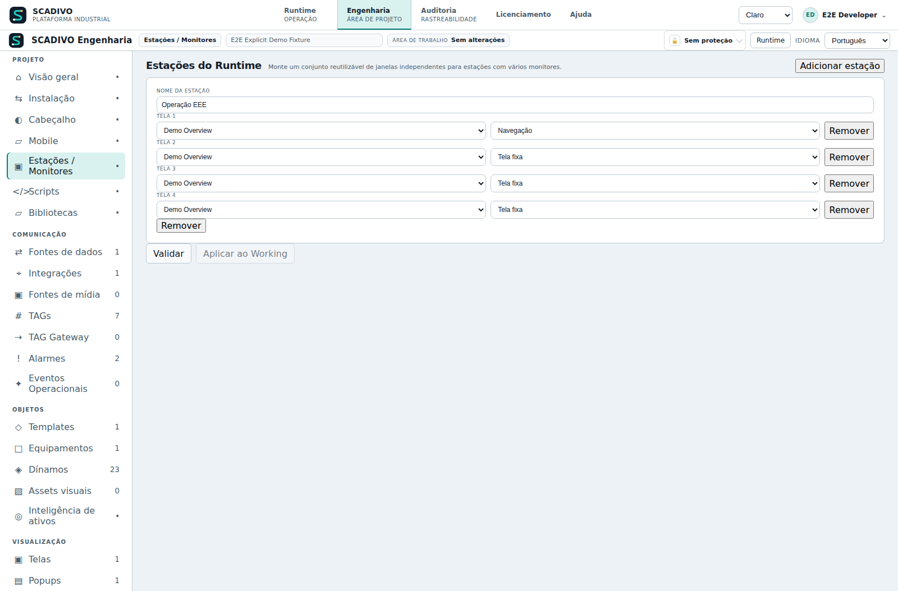
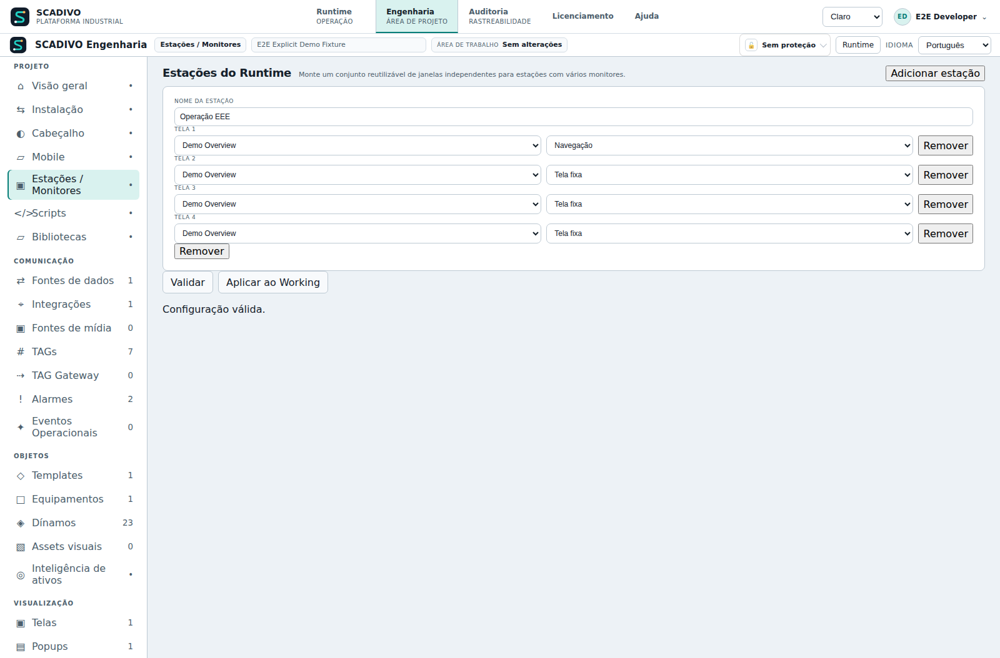

# Runtime stations across monitors

## Runtime stations: use windows across monitors

Choose a screen for each window, then arrange the windows on an extended desktop.

<!-- HELP-REVIEW-AFTER-PRODUCT-781: https://github.com/brunolrogerio-collab/EliteSCADA/issues/781; topic=runtime.station-multimonitor; fields=station.name,station.screen,station.mode,station.windows; status=WAITING_PREVIEW_ACCEPTANCE -->

### What a station profile organizes

A station groups one to four independent windows of the same Runtime application. For each window, the profile chooses the first screen and whether that window can navigate or stays on that screen. The profile does not select a physical monitor or save the window's position, size or scale. After opening the windows, arrange them manually with the operating system and browser. This also works when Runtime is reached over the network from a computer with several monitors.

### Configure the profile

1. Create and apply the screens you plan to use.
2. Open Engineering > Stations / Monitors and choose Add station.
3. Give the profile a name the team will recognize, such as EEE control room.
4. For each window, choose its first screen and behavior. Use Add window to add positions, up to four; each position becomes a Runtime window.
5. Select Validate and resolve any reported errors.
6. When the configuration is valid, choose Apply to Working.
7. Save and publish the revision, then activate it through the project lifecycle. The station appears in active Runtime only after activation.

### Understand the fields

The window number follows the order in which the windows open. It is not a monitor number. The selectors use screens already in the project; creating a station does not create or publish those screens.

| Field | Purpose and how to fill it | Example | Bounds |
| --- | --- | --- | --- |
| Station name | Identifies the set in the Runtime selector. Choose a name your team recognizes; it does not identify a computer or physical monitor. | EEE control room | The profile needs at least one window. |
| Screen for each window | Chooses which existing screen opens first in that window. Configure each row separately to place different information side by side. | Window 1: Overview; Window 2: Pumps | The screen must exist in the application being activated. |
| Window behavior | Navigation allows changing screens in that window. Fixed screen keeps the selected screen and requests a View Only session; it does not change the account's permissions. | Overview: Navigation; Pumps: Fixed screen | Each authenticated window counts as a separate Runtime connection. License limits and account permissions still apply. |
| Add window | Adds another screen to the set. Each row becomes an independent window when the station starts. | Four windows for four operating areas | A profile supports one to four windows; physical monitor placement is manual. |

### Start and arrange the windows

Open Runtime in a normal window with its header visible. If it is in full screen, exit full screen first. In the header, choose the station and select Start station. The browser may block new windows; if so, Runtime shows links to open them one at a time. Drag each window to the monitor you want. Resize it and, if useful, put each window in full screen. The product does not automatically detect or restore physical monitor position, orientation or scale.

### Permissions and connections for each window

A fixed window asks for View Only access; a navigation window asks for Interactive access. The server decides each authenticated window's access using the license limits and account permissions. Check the result in the account menu before sending commands. If no Interactive client is available, the window may be limited to View Only or denied access. View Only lets you follow the screen but does not allow commands. See also Runtime session: view, interact and end.

### End, reopen and troubleshoot

To end the session and free a license connection, open the account menu in each window and choose End session before closing it. Closing a window or losing a monitor does not tell the server that the connection ended. If a window closes unexpectedly, the license may keep counting that connection until the session expires automatically. To resume, start the station again and arrange the windows on the monitors; the product does not restore their previous positions.

If the station selector is missing, check that the header is enabled, Runtime is not in full screen and the revision in use includes the profile. If a window opens on the wrong screen, check the screen selected on that row and activate the updated revision. A fixed window that cannot change screens is working as configured. If Interactive access is limited or denied, check how many licensed connections are in use and the account permissions.

#### Visual example

These captures show the real interface in Portuguese during an automated test. The application name and “Demo Overview” are sample data; in your project, choose the right screen for each window.

**Before validation**

**After selecting Validate**

[Open this guide in installed Help](/help?topic=runtime.station-multimonitor)
