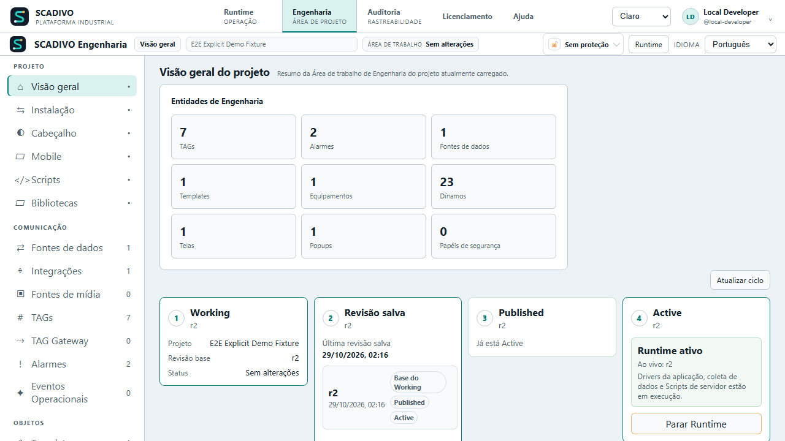
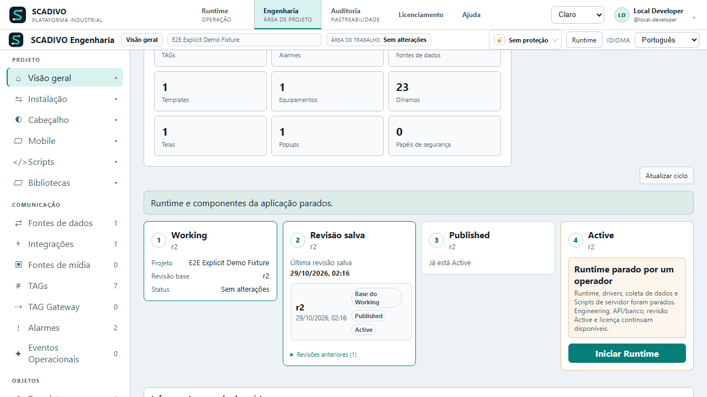

# Operación, seguridad y licencias

## Runtime

Runtime ejecuta la revisión Active bajo la autoridad del backend. La sesión recibe capabilities efectivas y, cuando corresponda, un lease de Runtime.

La pérdida/expiración de la autoridad interactiva no convierte la sesión en autorizada por defecto.

### Detener e iniciar la aplicación en operación

En la vista general de Engineering, la tarjeta **4 — Active** muestra el estado informado del Runtime. Con `EngineeringModify`, elija **Detener Runtime** y confirme. La acción detiene los drivers de la aplicación, la adquisición de datos y los Scripts de servidor. La revisión sigue Active; se conservan el servicio Engineering/API, la licencia instalada y el inicio de sesión del operador. Las sesiones Runtime y las conexiones con equipos pueden interrumpirse y deben reconectarse cuando Runtime vuelva. Detener no despublica la revisión ni revoca/elimina la licencia.

Después de una parada completa, **Iniciar Runtime** reanuda la misma revisión Active y vuelve a validar licencia y autoridad. No renueva ni reinicia un plazo limitado de Demo. Si la interfaz informa que la parada quedó incompleta, revise los componentes afectados antes de iniciar. Con HA habilitado, no se ofrecen controles locales porque no detendrían el clúster completo; use el mantenimiento coordinado del clúster.

Las capturas siguientes muestran ambas acciones en la vista general; se tomaron durante la validación local integrada.

Una renovación automática de licencia aceptada ocurre en segundo plano y por sí sola no detiene Runtime. Una licencia rechazada, revocada o vencida sigue las protecciones de entitlement del producto.

**Ayuda relacionada:** `/help?topic=engineering.lifecycle`, `/help?topic=licensing.overview`, `/help?topic=ha.overview`.

## Interactive y View Only

Interactive y View Only representan clases de sesión. View Only reduce la autoridad operacional; en particular, no concede acceso de escritura/comandos aunque el usuario tenga permisos que podría utilizar en una sesión interactiva.

La concesión de puestos/capacidad procede del entitlement de licencia y del servidor; los sockets o los controles visuales no son la unidad de autoridad.

## Commands

Commands representan la intención del operador y pasan por validación/autorización del lado del servidor. Un botón renderizado no demuestra que la acción vaya a aceptarse.

**Ayuda relacionada:** `/help?topic=bindings-commands.overview`.

## Diagnóstico y calidad de comunicación

Use diagnóstico por capas: backend, identidad/capabilities, Active, Data Source, Driver, conexión, binding, quality/timestamp y presentación. Ejecute las capabilities de Engineering del Driver solo cuando estén declaradas por su descriptor real.

**Ayuda relacionada:** `/help?topic=diagnostics.overview`.

## Authority, usuarios, roles, capabilities y scopes

Authority administra identidades y asignaciones. Los roles alimentan la autorización; las capabilities efectivas se calculan/aplican en el servidor.

No considere el nombre de un role como prueba suficiente de privilegio. El producto debe resolver las capabilities efectivas.

## Engineering Lock

Engineering Lock protege el contenido de desarrollo de la aplicación y es independiente de:

- la contraseña de la cuenta del usuario;
- la contraseña del backup de Authority;
- Licensing.

Cuando la aplicación está bloqueada, no se deben exponer los editores protegidos. Las funciones administrativas permitidas siguen sujetas a la autorización normal del backend.

Los cambios de Engineering Lock forman parte de Working y deben seguir Save/Publish/Activate para convertirse en estado Active duradero.

### Procedimiento: desbloquear la aplicación actual

**Requisitos previos:** acceso permitido a la administración restringida y el secreto correcto de Engineering Lock.

**Pasos:**
1. Abra la superficie de protección de la aplicación.
2. Introduzca el secreto de Engineering Lock.
3. Ejecute Unlock.
4. Confirme que Engineering vuelve a estar disponible conforme a las capabilities de la sesión.

**Resultado esperado:** solo se desbloquea la aplicación actual; la operación no autentica a un usuario ni cambia la licencia.

**Error esperado:** un secreto incorrecto mantiene Engineering bloqueado.

## Conceptos de licencia

Cuando no hay una licencia instalada, el estado es Demo. Una licencia válida tiene firma asimétrica y está vinculada a la máquina.

La licencia controla el entitlement comercial; no reemplaza Authority, Engineering Lock, lifecycle ni la validación del package.

### Demo/sin licencia

<!-- HELP-REVIEW-301: Revisar activación online y presentación de consumo tras su entrega. La duración ilimitada de Demo ya está descrita abajo. -->
**Próximas actualizaciones:** la activación online por cuenta y los indicadores de consumo siguen en desarrollo. Use las opciones disponibles en su versión; este texto no declara completo el flujo online.

Sin una licencia instalada, puede usar Runtime en Demo sin límite de tiempo:

- Engineering puede contener más de 200 TAGs, pero Run en Demo admite hasta 200 definiciones de TAG;
- Demo no tiene cuenta regresiva: no necesita detener e iniciar Run periódicamente;
- Runtime puede recuperarse después de un reinicio sin exigir la hora de inicio de una antigua sesión Demo;
- las cuotas son 2 clientes Interactive y 2 Solo visualización, compartidas por los clientes Runtime; HA e Inteligencia requieren su propia licencia;
- Licenciamiento muestra **Duración de Demo: Sin límite de tiempo**. Se siguen comprobando los permisos del usuario y los demás requisitos de operación.

Por encima de 200 TAGs, el producto rechaza Run completo y explica el límite; no elige silenciosamente solo una parte de las TAGs. El proyecto de Engineering y sus datos siguen disponibles.

Una licencia instalada pero inválida/tampered/wrong-hardware bloquea Run; no debe tratarse silenciosamente como si no hubiera licencia.

## Machine binding y Request

La instalación genera un Machine Request Code versionado a partir de la identidad estable de la máquina. El flujo normal no necesita exponer identificadores brutos de hardware al operador.

### Procedimiento: obtener el request

1. Abra Licensing.
2. Consulte el estado actual.
3. Copie el Machine Request Code.
4. Envíe solamente el request a la autoridad de licenciamiento.

**Resultado esperado:** el código puede utilizarse en la herramienta controlada de emisión sin distribuir la clave privada.

## Install / Replace / Remove

La instalación de la licencia valida la firma, el key ID, el vínculo de hardware y la validez antes de reemplazar el estado instalado.

Para reemplazarla, instale la nueva licencia validada mediante el flujo normal. Un intento inválido no debe reemplazar una licencia válida existente.

Remove elimina la licencia instalada; las activaciones futuras vuelven a las reglas de Demo, siempre que un estado externo inválido no bloquee Run.

## TAG tiers

Tiers documentados: 500, 1000, 1500, 3000, 5000 e Unlimited. Una licencia válida aplica el límite de TAGs y las funciones firmadas del nivel adquirido.

## Cuotas de sesión Runtime / Interactive / View Only

En **Licenciamiento**, cada límite aparece junto a **En uso**. Los TAGs son las definiciones de la aplicación en ejecución; Interactive y Solo visualización cuentan sesiones lógicas activas compartidas por los clientes Runtime. Reconectar la misma sesión no ocupa otro asiento. Pulse **Actualizar** para consultar de nuevo. Sin Runtime activo o si la lectura no está disponible temporalmente, se muestra **No disponible** en lugar de un cero inventado. Algunas licencias antiguas no especifican los límites de sesiones.

El estado de licenciamiento expone los entitlements de puestos View Only e Interactive cuando están presentes. El conteo y la aplicación corresponden al servidor; no debe confundirse una conexión de transporte con una sesión lógica licenciada.

## Entitlement de redundancia

El estado de licencia puede exponer un entitlement de HA Runtime. El entitlement habilita la superficie, pero no sustituye la configuración correcta, Authority, el transporte entre peers, fencing ni la verificación operacional.

## Alta disponibilidad: configurar y supervisar

La página **Alta disponibilidad** distingue Standalone de HA y presenta la configuración deseada y en ejecución, preparación, estado de nodos y peer, Active efectivo, salud, freshness, referencia de fencing e historial de operaciones. HA usa dos servidores redundantes; la topología de base de datos es una decisión separada y debe comprobarse en cada instalación.

### Preparar la configuración

1. Confirme una licencia con HA Runtime, dos servidores accesibles y una cuenta con `HighAvailabilityObserve`; para guardar u operar también se requiere `HighAvailabilityTransfer`.
2. En Engineering > Alta disponibilidad, seleccione HA para preparar la topología. Standalone sigue en ejecución mientras la preparación está pendiente.
3. Indique el endpoint principal de cada servidor. Mantenga el endpoint automático salvo que la red realmente requiera otra dirección externa. Configure la autenticación del peer; nunca incluya el secreto compartido en documentación o tickets de soporte.
4. Revise el nodo preferido. Si la topología usa protección, habilítela e indique la referencia compartida de fencing. El failover automático depende de esta protección.
5. Resuelva los requisitos de **Preparación para HA** y elija **Guardar configuración deseada**.
6. Si la página indica que se necesita reiniciar, la configuración deseada aún no está en ejecución. Programe el reinicio según el procedimiento operativo de la instalación; después actualice y confirme ambos nodos, peer, Active efectivo y protección.

### Transferencias y recuperación

Use **Switchover** para una transición planificada cuando este servidor sea el Active efectivo; el backend sigue validando la elegibilidad y puede rechazar la solicitud. Use **Failback** solo cuando el backend permita regresar al nodo preferido. **Recovery** y **Forzar resincronización** son acciones de recuperación para las condiciones indicadas en la página, no atajos para forzar que un nodo quede Ready. Lea la confirmación y compruebe el resultado/historial de la operación.

Antes de depender del failover automático, ensaye el escenario en la topología real y confirme las consecuencias para Runtime, base de datos y comandos duplicados. Un estado stale, degradado o ambiguo requiere investigar conectividad, freshness y fencing; no fuerce una promoción para quitar el aviso.

**Ayuda relacionada:** `/help?topic=ha.overview`, `/help?topic=licensing.overview`, `/help?topic=security.users-roles-capabilities`, `/help?topic=diagnostics.overview`.

## Puertos de red del paquete Docker estable

En **Engineering > Instalación > Red y servicios**, un usuario con `SystemAdmin` puede preparar puertos para la distribución Docker estable. La página muestra la configuración de Compose informada por el container actual, pero no puede confirmar por sí sola que el equipo host haya publicado cada puerto.

### Puertos controlados por este perfil

| Servicio | Predeterminado en host | Dentro del container | Observación |
| --- | ---: | ---: | --- |
| Web | `127.0.0.1:18080` | `80/TCP` | Navegación de Runtime y Engineering |
| API directa | `127.0.0.1:15080` | `5080/TCP` | Web reenvía `/api` a esta API |
| PostgreSQL | `127.0.0.1:15432` | `5432/TCP` | La publicación del host sigue limitada a loopback |
| Control MediaMTX | Sin publicar | `9997/TCP` por defecto | Puerto interno configurable |
| HLS | Sin publicar | `8888/TCP` por defecto | Puerto interno configurable |

Los puertos internos de control MediaMTX y HLS se pueden cambiar en este perfil y permanecen privados en la red Docker. La configuración también actualiza las direcciones que la API usa para conectarse al servicio multimedia. Runtime entrega el vídeo mediante el relay de la API con tickets temporales; no publique MediaMTX directamente en el host.

Los puertos de protocolo de los Drivers se configuran en cada Data Source según la conexión y el equipo. Este perfil no publica listeners de Drivers ni cambia los puertos de equipos externos. Consulte las guías de [conexiones y protocolos](21-CONEXIONES-Y-PROTOCOLOS.md), [BACnet/IP](22-HOME-BUILDING-CONEXIONES.md) y [Modbus TCP Server](25-TELECONTROL-Y-MODBUS-SERVER.md).

Los puertos de bases remotas y las direcciones de peers HA pertenecen a sus propias integraciones. Esta página no abre firewalls ni cambia servicios externos.

### Cambiar puertos de la misma instalación

1. Abra **Engineering > Instalación > Red y servicios** y revise el ID, binds y puertos actuales.
2. Indique puertos enteros de 1 a 65535. Los puertos del host para Web, API y base deben ser distintos; los puertos internos de control multimedia y HLS también deben ser distintos entre sí. Web y API pueden vincularse a `127.0.0.1` (solo host) o a `0.0.0.0` (todas las interfaces). La base permanece en `127.0.0.1`; multimedia sigue privada en la red Docker.
3. Revise la nueva dirección y el impacto del reinicio. Por ejemplo, si Web usa `28080`, la navegación pasa a `http://localhost:28080`.
4. Descargue el script PowerShell (Windows/Docker Desktop) o Bash (Linux), colóquelo junto a `docker-compose.stable.yml` y `.env`, revíselo y ejecute el comando mostrado en una terminal del host Docker.
5. El script comprueba la disponibilidad de puertos del host, conflictos entre puertos internos multimedia y `docker compose config` antes del cambio. Después crea una copia de `.env`, aplica el perfil y verifica Web, API, base y listeners multimedia privados. No elimina volúmenes. Si una verificación falla, intenta restaurar `.env` y los servicios anteriores.
6. Abra la nueva dirección Web. La pestaña anterior puede desconectarse mientras se recrea el container.

No incluya secretos en el comando: solo contiene ID de instancia, direcciones bind y números de puerto. `.env` permanece en el host; la copia `.env.network-backup-*` y `network-profile-audit.log` también quedan en la carpeta de instalación.

### Crear otra instalación

Use otra carpeta, cree un `.env` independiente con contraseñas/claves/identidad propias y defina allí el nuevo `SCADIVO_INSTALLATION_ID` antes de ejecutar el comando. No copie el `.env` de la primera instalación. En modo de segunda instalación, el script exige que el ID ya esté definido en el nuevo `.env` y rechaza uno que ya tenga containers o volúmenes. El ID separa el proyecto Compose y sus volúmenes, así que la nueva instalación empieza con base y datos propios; no duplica los datos de la primera.

Vincular Web/API a `0.0.0.0` permite responder en todas las interfaces de red. Para acceso remoto, configure explícitamente TLS/reverse proxy y la política del firewall fuera de SCADIVO. Si HA está habilitado, actualice peers y compruebe su salud después de cambiar URLs; el producto no lo hace automáticamente.

### Recuperar el acceso

Si la página deja de abrir, use la nueva dirección indicada en el perfil. Si el script informa rollback, conserve la copia y revise logs/salud en el host. Para restaurar manualmente, copie el `.env.network-backup-*` correcto a `.env` y ejecute `docker compose -f docker-compose.stable.yml up -d` en la carpeta de esa instalación. No use `down -v`: elimina datos persistentes.

**Ayuda relacionada:** `/help?topic=installation.network-ports`, [instalación Docker estable](../../LOCAL-DOCKER-STABLE.md).

## License Generator

License Generator es una herramienta offline/controlada de la autoridad de licenciamiento. La clave privada de firma nunca debe incluirse en GitHub, CI normal, un instalador de cliente ni Runtime.

Los usuarios finales de EliteSCADA usan request/install; solo el personal autorizado de emisión debe operar el entorno de firma.

**Ayuda relacionada:** `/help?topic=licensing.overview`.
