# Inteligencia de Activos y Procesos

Este capítulo describe los flujos disponibles actualmente. Inteligencia es opcional: la licencia habilita la función, pero usted configura los equipos, perfiles y etapas que pretende analizar. No necesita aplicar análisis a toda la planta.

**Ayuda contextual:** `/help?topic=intelligence.overview`.

## Empiece por una pregunta pequeña

Imagine Bomba 01. SCADIVO ya recibe corriente y velocidad y usted quiere investigar si cambió la corriente en condiciones de operación similares. Empiece por esa pregunta sin configurar toda la planta. Una comparación orienta la investigación; no demuestra por sí sola eficiencia física ni un defecto.

Los nombres del editor representan partes de esta tarea:

| Nombre | Significado en este ejemplo |
| --- | --- |
| TAG | La variable que proporciona corriente o velocidad. |
| Perfil de medición | La ficha que reúne señales elegidas y significado de cada una. |
| Asociación | El vínculo de esa ficha con Bomba 01 registrada como Equipo. |
| Contexto operacional | La condición en que deben compararse datos, como un intervalo de operación definido. |
| Etapa del proceso | Un grupo ordenado de asociaciones, como los equipos de bombeo. No programa arranques. |
| Cobertura | La consulta que muestra qué datos utilizables hay en el período. |

Siga este recorrido y profundice en las secciones siguientes:

1. Compruebe TAGs existentes, unidades y datos guardados del período. No invente sensores ausentes.
2. Monte el perfil y asócielo a Bomba 01. Los selectores gestionan los IDs internos.
3. Guarde la configuración, elija dónde usar Intelligence, publique/active la revisión y habilite explícitamente el recurso para análisis. Licencia, configuración y ejecución autorizada son condiciones separadas.
4. Consulte cobertura primero. Elija después solo análisis cuyos requisitos cumplen sus señales. Un resultado no disponible requiere comprobación; no debe leerse como cero.
5. Para una vista del operador, genere una pantalla, revísela en el editor normal y siga publicación/activación. Abre en Runtime y las consultas requieren solicitud explícita; generar no consulta datos ni pone automáticamente la pantalla en operación.

Puede empezar por un equipo. Contextos y etapas se añaden cuando sirven a la pregunta. Más adelante encontrará horarios, papeles de señales y límites para consultar al configurar.

Use ¿Dónde desea trabajar? para ir directamente a perfiles, asignaciones, contextos, etapas, panel o equipos y ubicaciones habilitados para análisis. Empiece por perfiles y asignaciones; contextos y etapas solo son necesarios cuando su análisis los utiliza. Navegar conserva el borrador sin guardar ni ejecutar análisis.

Listo para consultar significa que el elemento está activado para la revisión actual. Si aparece Debe reactivar antes de consultar, revise licencia y permisos y seleccione Activar de nuevo. Puede ser necesario tras reiniciar o restaurar la autorización. El encabezado muestra el nombre de la aplicación; la revisión activa identifica la versión publicada en uso.

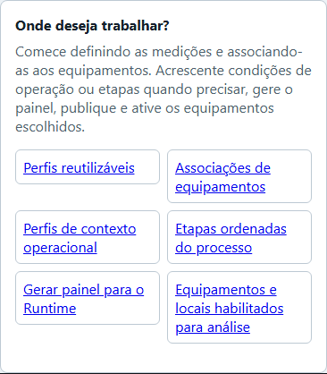

## 1. Empezar por el equipo y los TAGs

Elija el Equipo ya registrado y los TAGs de mediciones útiles, como corriente, tensión, presión, caudal o temperatura. En cada TAG compruebe tipo de valor y unidad. Quality informa la condición de la lectura; timestamp es su hora de origen. Historian es el histórico guardado, que debe tener datos del período elegido. Incluya una señal por la pregunta que ayuda a responder, no solo porque exista.

Para editar, su cuenta necesita los permisos `EngineeringModify` y `AssetProcessIntelligenceManage`. El segundo debe concederse explícitamente para todos los recursos o para el equipo/lugar que configurará. Compruebe también la licencia Intelligence. El nombre del rol no sustituye el permiso efectivo.

## 2. Crear un perfil de medición y una asignación

1. Abra Engineering > Inteligencia de activos y cree un Perfil de medición. Asígnele un nombre que ayude a reconocer el conjunto, como “Bomba de transferencia”.
2. Añada los TAGs que describen el equipo. Para cada TAG, explique qué mide, indique si el análisis lo necesita y complete los detalles de medición solicitados. Compruebe la unidad y la referencia real del TAG.
3. Guarde la configuración en Working.
4. En las asignaciones, elija el Equipo existente y el perfil. Un equipo puede usar más de un perfil.
5. Revise las referencias ausentes y duplicadas antes de guardar y seguir el lifecycle normal del proyecto.

El perfil organiza referencias y significado de señales. El sistema crea sus claves internas; no necesita inventar IDs ni códigos. El perfil no crea TAGs, no habilita por sí solo la captura de Historian ni demuestra que los instrumentos estén calibrados.

## 3. Configurar el contexto operacional

Mayor corriente puede ser esperable si aumenta velocidad o carga. El contexto explicita condiciones, como bomba en marcha y velocidad dentro de un intervalo, para seleccionar evidencia comparable. No aprende automáticamente el modo ni convierte correlación en diagnóstico. Defina límites con conocimiento del equipo.

Elija la asociación del equipo y dé al contexto un nombre que explique la condición, como “Bomba encendida con caudal normal”. Añada al menos una condición usando un TAG del perfil asociado. El sistema crea la clave interna del contexto.

Para números, el intervalo incluye mínimo y máximo en la unidad actual del TAG. Para booleanos, elija True o False. Para String o Enum, use el valor exacto, incluidas mayúsculas cuando corresponda.

Todas las condiciones deben coincidir con lecturas que tengan exactamente la misma hora UTC de origen. Lecturas solo próximas no bastan. Si otra edición cambia el contexto, actualice la pantalla y revise sus condiciones antes de guardar.

## 4. Organizar etapas del proceso

Use **Etapas ordenadas del proceso** para montar la secuencia que desea supervisar. Dé a cada etapa un nombre legible, añada las asignaciones de Equipo/perfil y ajuste el orden. El sistema crea la clave interna de cada etapa. La etapa organiza miembros, pero no infiere por sí sola causalidad, balance ni un KPI agregado del proceso.

Guarde la configuración en Working. Los datos y análisis de Runtime siguen sujetos a la revisión Active y a las autorizaciones vigentes.

Para una etapa, el mismo generador ofrece Cobertura por equipo y Análisis por equipo. La lista muestra qué tiene configurado cada miembro. Use Configurar este equipo para elegir reglas y señales pendientes y vuelva al generador. No necesita configurar desviación en todos para generar rendimiento en los demás. Las vistas elegidas son Pantallas vinculadas y editables. En Runtime, elija el equipo y el análisis, indique el período y consulte. Cada resultado pertenece solo al equipo elegido.

Para revisar una referencia en Runtime, elija un perfil de equipo en el generador y marque Revisar datos de referencia. Agrega una Pantalla propia; no requiere configurar rendimiento o desviación. Aplique el conjunto, guarde, publique y active. En Runtime en vivo, abra Datos de referencia, elija un período conocido y seleccione Consultar referencia. Verá lecturas recibidas, aceptadas y rechazadas por señal y cuántas se pudieron usar juntas. Para comparar otro período, marque Comparar con otro período e indique un intervalo posterior sin solapamiento. Un número alto no demuestra que el equipo estuviera sano. Cambiar los períodos borra el resultado. El editor y la reproducción histórica no ejecutan esta consulta.

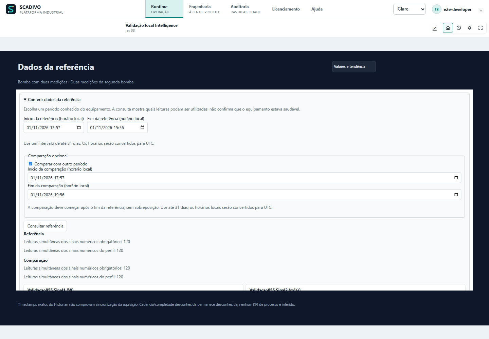

Para consultar referencias de los equipos de una etapa, elija la etapa en el generador y marque Datos de referencia por equipo. No necesita configurar rendimiento o desviación. Usa la misma Pantalla de análisis de etapa; el conjunto sigue teniendo hasta tres Pantallas. En Runtime, abra Análisis por equipo, elija el equipo y seleccione Datos de referencia. Indique los períodos y consulte. Elegir otro equipo cierra el informe anterior, cancela una consulta pendiente y borra su resultado; no se consulta automáticamente el nuevo equipo.

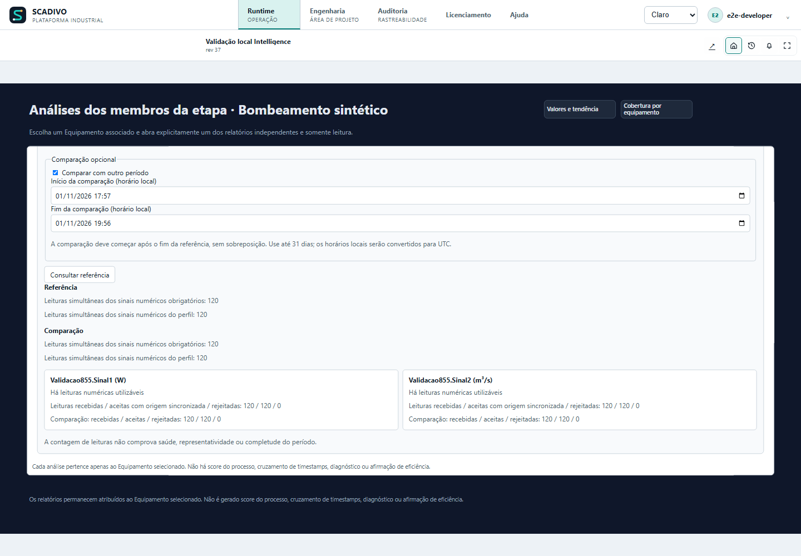

Para llevar las condiciones de operación al Runtime, primero guarde un contexto en la asignación del equipo. En el generador, elija ese perfil y marque Condiciones de operación. Añade una Pantalla propia y funciona sin rendimiento o desviación configurados. Aplique el conjunto, guarde, publique y active. En Runtime en vivo, abra Condiciones de operación, elija Contexto guardado por nombre, indique inicio y fin del período y seleccione Consultar condiciones. Para comparar, use un período posterior sin solapamiento. El resultado muestra cuántas lecturas cumplen cada condición y cuántas cumplen todas a la vez. Por ejemplo, una condición de presión entre 0 y 200 kPa puede seleccionar lecturas que un intervalo de 0 a 50 kPa excluye. Cero lecturas compatibles no significa equipo sano: significa que el período no proporciona datos en las condiciones elegidas. Cambiar el contexto o los períodos borra el resultado anterior. Si el contexto cambia en Ingeniería, genere y publique de nuevo la vista; no asume una nueva versión silenciosamente. El editor y la reproducción histórica no ejecutan la consulta.

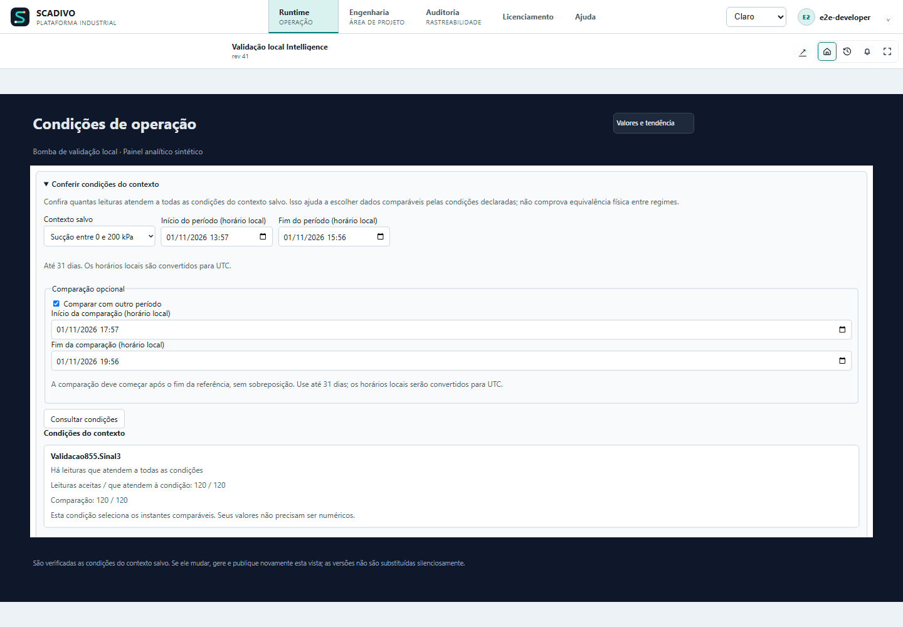

Para consultar condiciones de los equipos de una etapa, elija la etapa en el generador y marque Condiciones de operación por equipo. Basta con un contexto guardado en al menos una asignación de la etapa; no requiere configurar rendimiento o desviación. Las condiciones usan la misma Pantalla de análisis, manteniendo el conjunto con hasta tres Pantallas. En Runtime, abra Análisis por equipo, elija el equipo, seleccione Condiciones de operación y elija Contexto guardado por nombre. Indique los períodos y consulte. Solo aparecen contextos de ese equipo. Si no tiene un contexto incluido, la página explica qué falta y mantiene sus otros análisis disponibles. Cambiar de equipo o análisis cierra el informe anterior, cancela la lectura pendiente y borra el resultado. No se consulta automáticamente. Si cambia un contexto en Ingeniería, genere y publique de nuevo la vista para usar su nueva versión.

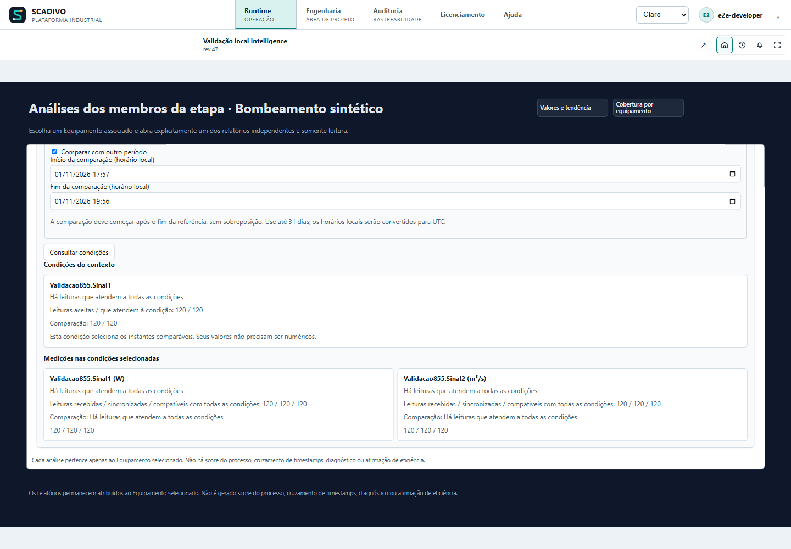

Para ver la desviación conjunta en Runtime, elija un perfil de equipo en el generador y marque Desviación conjunta experimental. Necesita un contexto guardado y al menos dos mediciones numéricas distintas fuera de sus condiciones. Añade una Pantalla propia sin requerir rendimiento o desviación contextual. Aplique el conjunto, guarde, publique y active.

En Runtime en vivo, abra Desviación conjunta (experimental), elija Contexto guardado y marque de dos a ocho mediciones por nombre. Indique el intervalo real entre lecturas en segundos: por ejemplo, 60 para una lectura por minuto. Elija referencia y evaluación sin solapamiento y seleccione Calcular desviación conjunta. Abrir la Pantalla no consulta.

Primero revise cuántos instantes completos sustentan la referencia, cuántos produjeron score y cuántos estaban en calentamiento. Datos insuficientes no significan funcionamiento normal: revise contexto, períodos y lecturas. Abra Contribuciones de las mediciones para investigar cuáles variaron. El score describe alejamiento de la referencia sin unidad física; un número mayor no confirma un fallo.

Es experimental, validado por simulación, sin predicción de vida útil ni umbral de alarma validado en campo.

Cambiar contexto, mediciones, cadencia o períodos borra el resultado. El editor y reproducción histórica no calculan. Si cambia el contexto en Ingeniería, genere y publique de nuevo.

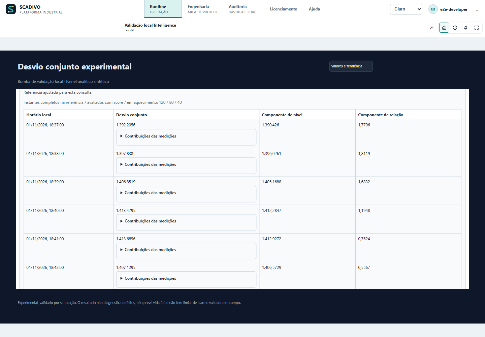

Para incluir desviación conjunta en los equipos de una etapa, elija la etapa en el generador y marque Desviación conjunta experimental por equipo. Al menos una asignación necesita contexto guardado que deje dos mediciones numéricas distintas fuera de sus condiciones. No requiere seleccionar rendimiento, referencia o condiciones de operación. Usa la misma Pantalla de análisis, manteniendo hasta tres Pantallas en el conjunto. Aplique, guarde, publique y active.

En Runtime, abra Análisis por equipo, elija el equipo y seleccione Desviación conjunta (experimental). Elija contexto y mediciones por nombre, indique cadencia real y períodos y solicite el cálculo. El resultado pertenece solo al equipo elegido. Si otro miembro no cumple los requisitos, la página explica la ausencia y mantiene las otras vistas disponibles. Cambiar equipo o análisis cierra el formulario anterior, cancela la lectura pendiente y borra el resultado; no consulta automáticamente. El score sigue siendo experimental, sin diagnóstico, predicción de vida útil ni umbral de alarma validado en campo.

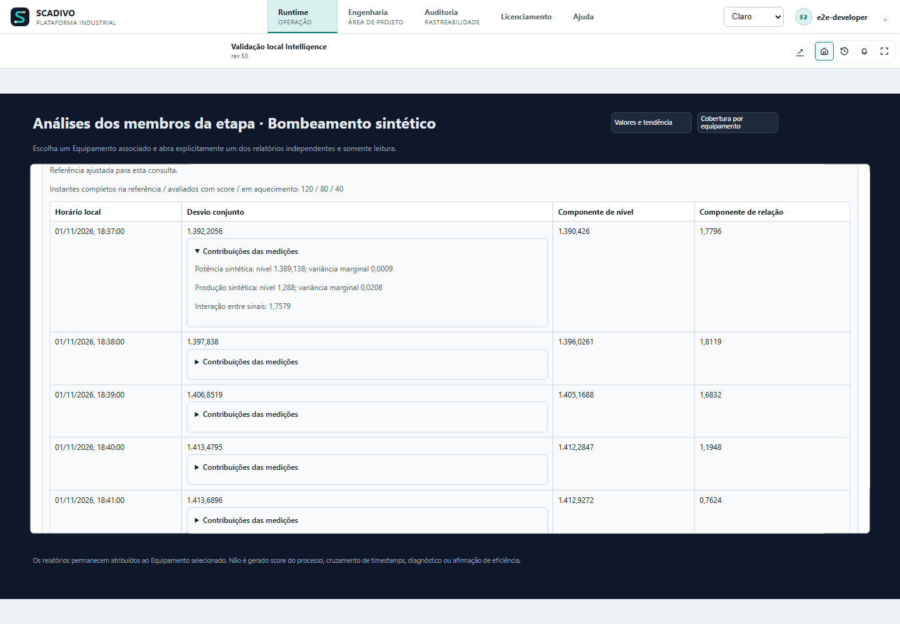

## 5. Solicitar análisis

Seleccione el Equipo asignado y elija el análisis disponible, como cobertura del perfil, rendimiento o desviación contextual. Defina el período y solicite explícitamente la consulta. La desviación contextual requiere condiciones operacionales configuradas y evidencia temporal suficiente. El análisis es de solo lectura; no cambia un TAG, no controla equipos ni sustituye Alarmas.

Interprete el resultado junto con cobertura, quality, timestamps y las limitaciones de cada señal. La ausencia, quality deficiente, falta de historial o desalineación temporal no significan cero, operación normal ni falla confirmada. Los análisis actuales no son un diagnóstico de mantenimiento ni una prueba de eficiencia física. Para miembros de una etapa, examine un equipo a la vez; no combine resultados independientes como un score del proceso.

**Ayuda contextual:** `/help?topic=intelligence.process-stage-member-insights`.

## 6. Generar borradores de Pantallas

Guarde primero los cambios pendientes de la configuración de Intelligence. En la parte superior de la página, localice **Crear un panel para Runtime** y elija un perfil de equipo o una etapa del proceso en **Contenido del panel**. La lista muestra nombres ya registrados; no es necesario escribir IDs. El generador básico necesita al menos un TAG numérico resuelto. Si no puede elegir una fuente, complete el perfil, la asignación o la etapa y compruebe la licencia y los permisos.

Pulse **Generar borrador del panel**. SCADIVO abre una Pantalla normal y editable en el editor canónico, con tarjetas de valores, una tendencia y cobertura organizadas a partir de TAGs existentes. Es un borrador: no consulta valores actuales ni Historian, no inventa KPI ni publica la Pantalla.

En el editor, revise nombres, unidades, dimensiones, vínculos y legibilidad. Use **Preview** y **Aplicar al Workspace**; luego guarde, publique y active la revisión del proyecto, y configure/compruebe la navegación de Runtime. Solo entonces los operadores podrán abrir la Pantalla. Las acciones guiadas especializadas aparecen junto a sus análisis y pueden pedir reglas o intervalos adicionales.

Si el generador crea Pantallas vinculadas, Preview y Aplicar al Workspace incluyen el conjunto completo para conservar los destinos de navegación. Revise el conjunto antes de aplicar.

## 7. Problemas comunes

### Elegir objetos y análisis del panel

Después de elegir la fuente, abra cada medición en **Objetos de medición**. Elija valor numérico, dial semicircular, anillo, barra horizontal, regla vertical, intervalos o valor con meta. La presentación no cambia el TAG ni el cálculo. Los temas de objetos son claro, oscuro o alto contraste.

Los objetos con escala requieren mínimo y máximo reales en la unidad del TAG. Se rellena una escala válida ya registrada; de lo contrario, indique límites reales. Los intervalos necesitan dos límites ordenados dentro de la escala y la meta debe estar dentro de sus límites. Los rangos incompletos o inválidos bloquean la generación. Use Valor numérico si no conoce una escala adecuada.

En **Análisis del panel**, rendimiento y desviación contextual quedan disponibles cuando sus selecciones en la asignación estén completas. Use **Configurar análisis de la asignación** para acceder a los controles existentes. Cada análisis puede incluirse por separado. Las vistas generadas reciben botones de navegación entre Pantallas. Un análisis no disponible no bloquea las otras vistas; lea el motivo antes de cambiar el significado de las señales.

Los paneles generados usan un fondo oscuro propio para conservar el contraste en ambos temas del sistema. Puede cambiarlo en Fondo, en el editor de Pantallas; compruebe también los colores de textos y valores al elegir otro fondo.

- **Recurso bloqueado:** compruebe licencia, `EngineeringModify`, `AssetProcessIntelligenceManage` y scope.
- **Perfil/asignación incompletos:** compruebe equipo, perfil, TAGs y calificadores obligatorios.
- **Sin cobertura/historial:** confirme que el TAG recibía muestras útiles con quality y timestamps y que había captura en el período. Historian no completa datos retroactivamente.
- **Sin coincidencia de contexto:** revise las condiciones, la unidad, el intervalo y si las lecturas tienen la misma hora de origen.
- **Borrador no disponible:** complete las selecciones requeridas por ese tipo de Pantalla y refine el resultado en el editor normal.
- **El resultado cambia tras editar:** guarde la configuración correcta, compruebe la revisión Active y solicite explícitamente una consulta nueva.

**Ayuda relacionada:** `/help?topic=historian.overview`, `/help?topic=tags.quality`, `/help?topic=tags.timestamps`, `/help?topic=screens.overview`, `/help?topic=engineering.lifecycle`.

## Revise los datos antes de interpretar

En Ingeniería > Inteligencia de activos, localice la asignación del equipo. En Revisar datos de referencia, elija inicio y fin de un período conocido y pulse Consultar referencia. Las horas son locales y se convierten a UTC. Cada período admite hasta 31 días. Las lecturas aceptadas tienen la evidencia de origen exigida; los rechazos explican por qué se excluyeron otras lecturas. El conteo no demuestra que el equipo estuviera sano.

En Revisar condiciones del contexto, seleccione un contexto guardado por su nombre y consulte el período. SCADIVO usa su versión guardada automáticamente. El resultado indica cuántas lecturas cumplen todas las condiciones en el mismo instante de origen. Cero lecturas compatibles puede indicar condiciones no cumplidas o datos insuficientes; lea la explicación. Publique los cambios y active el equipo antes de consultar.

## Use la desviación conjunta experimental

Abra Desviación conjunta experimental en la asignación. Elija el contexto guardado y de dos a ocho mediciones numéricas; las mediciones que definen las condiciones del contexto se excluyen de los objetivos. Indique el intervalo real de adquisición en segundos, de 1 a 86.400. No invente ese valor: describe la frecuencia esperada de las lecturas. Elija una referencia y un período posterior de evaluación sin superposición, y pulse Calcular desviación conjunta.

El resultado muestra instantes evaluados y en calentamiento. La desviación combina cambios de nivel y de la relación entre señales. Expanda Contribuciones de las mediciones para investigar la participación de cada señal. Los números no tienen unidad física ni diagnostican causas, fallos o vida útil. La función es experimental, validada solo por simulación y sin umbral de alarma validado en campo.

Use Cancelar consulta para interrumpir. Cambiar períodos, contexto, señales o cadencia descarta el resultado anterior; consulte de nuevo. Si no se puede ajustar la referencia, revise datos, calidad, sincronización, contexto y variación de señales antes de ampliar períodos.

## Entienda los conteos y las condiciones

Los análisis se consultan bajo demanda: editar perfiles o activar un alcance no inicia análisis continuo. En la referencia, lea los motivos junto a No disponible. Una señal obligatoria de texto, opción o verdadero/falso no entra en la cohorte numérica obligatoria; los conteos numéricos del perfil se muestran por separado. Un conteo cero de un tipo no consultado no demuestra ausencia de histórico.

En las consultas de contexto, revise primero Condiciones del contexto: lecturas aceptadas y cuántas cumplieron cada condición. Un modo textual puede seleccionar instantes válidos de corriente o caudal. Después revise las mediciones en las condiciones seleccionadas. Estos conteos no demuestran salud ni eficiencia.

## Compare dos períodos y cancele consultas

En las consultas de referencia y condiciones del contexto, marque Comparar con otro período para revisar evidencia en dos ventanas. Indique inicio y fin de la comparación. Cada ventana admite hasta 31 días, y la comparación debe comenzar estrictamente después del fin de referencia: no use el mismo instante en ambos límites. La consulta permanece deshabilitada con campos vacíos, fechas invertidas o superposición.

Consulte y lea los conteos de cada período. Comparar conteos no es, por sí solo, un indicador de eficiencia. Desmarcar la comparación o cambiar cualquier límite elimina el resultado anterior. Durante la lectura, use Cancelar consulta: una respuesta tardía no debe reaparecer. Para consultar de nuevo, revise los parámetros y pulse el botón de consulta.

<!-- installed-system-guides -->

## Intelligence: habilitar, pausar y resolver bloqueos

Elija qué equipos analizar, prepare la configuración y active su uso. Tener la licencia no inicia análisis automáticamente.

<!-- HELP-REVIEW-AFTER-PRODUCT-858-INTELLIGENCE: https://github.com/brunolrogerio-collab/EliteSCADA/issues/858; topic=intelligence.activation; fields=; status=WAITING_PRODUCT_IMPLEMENTATION_AND_VALIDATION -->

### Siga la secuencia completa

Empiece con un equipo, como Bomba 01. Abra Ingeniería > Inteligencia de activos. Reunirá sus variables, indicará a qué equipo pertenecen y elegirá dónde usar el análisis.

El perfil reúne señales y significados. La asociación vincula ese perfil al Equipo registrado. Configure contextos y etapas solo cuando sirvan a su pregunta. Después guarde, publique y active la revisión del proyecto.

Queda una decisión separada: activar explícitamente el recurso elegido para permitir análisis. Crear el perfil, marcar una casilla o tener la licencia no hace esa activación por usted.

Use ¿Dónde desea trabajar? para ir directamente a perfiles, asignaciones, contextos, etapas, panel o equipos y ubicaciones habilitados para análisis. Empiece por perfiles y asignaciones; contextos y etapas solo son necesarios cuando su análisis los utiliza. Navegar conserva el borrador sin guardar ni ejecutar análisis.

Listo para consultar significa que el elemento está activado para la revisión actual. Si aparece Debe reactivar antes de consultar, revise licencia y permisos y seleccione Activar de nuevo. Puede ser necesario tras reiniciar o restaurar la autorización. El encabezado muestra el nombre de la aplicación; la revisión activa identifica la versión publicada en uso.

### Quién configura y quién puede activar o pausar

El desarrollador prepara perfiles, asociaciones y selección de equipos o lugares con permiso de edición de Ingeniería. El gestor puede tener acceso de lectura a Ingeniería (EngineeringView) y permiso para administrar Intelligence solo en sus recursos (AssetProcessIntelligenceManage), sin EngineeringModify.

Abra Inteligencia de activos y use Activar o Pausar en un recurso ya seleccionado por el desarrollador. Editar selección, perfiles, TAGs o pantallas sigue bloqueado. El permiso se comprueba en el equipo o lugar; el nombre del rol no sustituye una concesión. Las consultas requieren también licencia, TrendUse y lectura de TAGs.

La operación requiere la misma revisión activa que abrió y ninguna edición pendiente. Si otro autor tiene un borrador, pídale finalizarlo o descartarlo y actualice la página. La operación puede crear una revisión persistente con solo el cambio de activación del recurso; no publica cambios de otros objetos. Tras reiniciar, vuelva a Activar para permitir consultas. Si Pausar devuelve un error, no suponga que la pausa durable terminó: compruebe el estado y reintente después de resolver el bloqueo.

### Activar solo donde sea útil

1. En Alcances elegibles, seleccione solo equipos o lugares que desea analizar. Aquí, alcance significa esa selección de recursos.
2. Guarde los alcances y la configuración preparada.
3. Publique y active la revisión del proyecto. Resuelva cambios pendientes antes de permitir ejecución.
4. En la fila del recurso use Activar y compruebe que el permiso queda armado, es decir, habilitado para ese recurso.
5. Abra la consulta de la asociación, elija el período y solicite el análisis. Activar permite consultar; no hace la consulta automáticamente.
6. Use Pausar para interrumpir análisis. Se cancela el trabajo pendiente, pero quedan TAGs e histórico. Pause un recurso antes de retirarlo de la selección.

### Activo configurado no significa habilitado

Si se revocó un permiso, el recurso puede seguir marcado Activo en la configuración y tener la ejecución bloqueada. Son datos distintos: lo configurado y lo autorizado ahora.

Restaurar la concesión no reinicia el trabajo silenciosamente. Compruebe el estado y use Activar de nuevo, incluso tras reiniciar cuando lo pida la pantalla. Requiere una decisión explícita del responsable. Compruebe esto antes de investigar datos ausentes en el histórico guardado, llamado Historian.

### Ejemplo: empezar pequeño

Para Bomba 01, empiece con corriente y velocidad si existen esas mediciones. Elija análisis que las acepten. Con nuevas mediciones podrá ampliar el perfil y usar otros análisis compatibles.

Mantenga pausados los recursos que no usará. No invente una señal de vibración ausente. La selección limita lo autorizado a ejecutar, pero no garantiza un consumo fijo de procesador o memoria.

#### Operación con acceso restringido

Cuenta gestora real: puede pausar el equipo autorizado; otra bomba y edición de selección siguen bloqueadas. El área requiere reactivación tras cambiar la revisión. API y PostgreSQL reales, aplicación sintética.

**Cuenta gestora real: puede pausar el equipo autorizado; otra bomba y edición de selección siguen bloqueadas. El área requiere reactivación tras cambiar la revisión. API y PostgreSQL reales, aplicación sintética.**

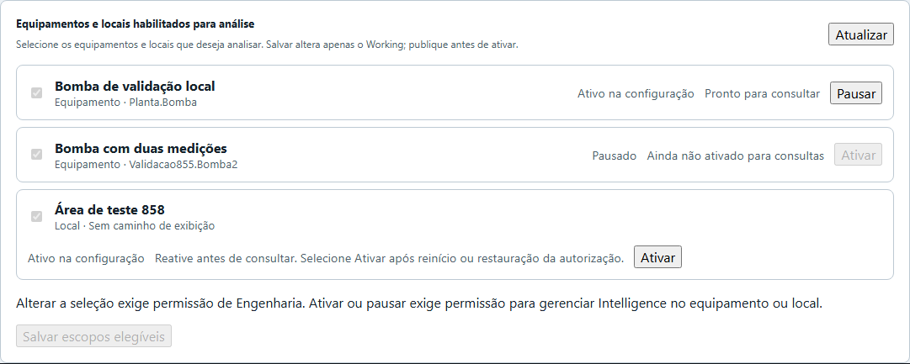

[Abrir esta guía en Ayuda instalada](/help?topic=intelligence.activation)

## Intelligence: significado de señales y unidades

Describa qué se midió, no solo el nombre del TAG.

### Por qué no basta el nombre

Antes de calcular, indique qué mide cada variable. Un TAG llamado Potencia puede ser potencia activa, aparente o un cálculo; Presión puede medir aspiración, descarga o su diferencia. El nombre no basta para elegir la fórmula correcta.

En el perfil seleccione el papel semántico solicitado: la opción que identifica el significado de la señal para el análisis. Complete después los calificadores mostrados, los detalles que precisan esa elección. El texto de papel heredado sigue siendo descriptivo; no sustituye esa selección.

### Campos y elecciones

Consulte esta tabla si tiene dudas en el perfil. Los selectores muestran las opciones aceptadas por el catálogo actual. Elija la correspondiente al instrumento y al proceso, aunque otra opción habilitara un cálculo.

| Campo | Finalidad y cómo rellenarlo | Ejemplo | Límites |
| --- | --- | --- | --- |
| Obligatorio | Marca señales cuya ausencia compromete cobertura. No haga opcional una señal esencial solo para obtener resultado. | Corriente necesaria para comparación |  |
| Papel semántico | Elija qué representa la señal en el cálculo: magnitud y función en la máquina. El análisis usa esa opción controlada; no lo adivina por el nombre del TAG. | Potencia activa de entrada, si se mide |  |
| Base de corriente | Indique la base de corriente del instrumento admitida por el papel, como RMS cuando corresponda. Si la etiqueta solo dice corriente, confirme la medición antes de elegir. | Seleccione opción documentada del instrumento |  |
| Tipo de señal | Distingue medición, referencia y función exigida. Una consigna no prueba valor medido. | Medición real cuando se exija |  |
| Referencia de presión | Indique qué presión se midió. La diferencia salida menos entrada no es la presión de descarga sola; elija la base exigida por el papel y confirmada por el instrumento. | Diferencial medido salida − entrada |  |
| Dirección del flujo | Identifica sentido de transferencia; el opuesto puede invalidar regla. | Bomba hacia proceso, si corresponde |  |
| Referencia de frecuencia | Explica frecuencia según catálogo; distinga referencia eléctrica y velocidad física. | Compruebe origen del instrumento |  |
| TAG y unidad | Seleccione TAG real y unidad controlada. Cambiar rótulo no convierte datos. Algunos cálculos exigen unidades/versiones específicas. | kW para potencia si corresponde al dato real |  |

### Ejemplo: no confundir indicador con eficiencia

Suponga que aumenta la corriente de la bomba mientras la velocidad permanece igual. Puede orientar una investigación, pero la corriente por sí sola no calcula la eficiencia física del motor. Es un indicador sustituto, también llamado proxy.

Otras reglas pueden usar potencia eléctrica de entrada, caudal y diferencia de presión. Solo están disponibles cuando las señales cumplen los papeles, unidades y alineación exigidos. Si falta una medición o detalle necesario, lea el motivo de indisponibilidad; no introduzca valores ficticios para habilitar la regla.

[Abrir esta guía en Ayuda instalada](/help?topic=intelligence.semantics)

## Intelligence: consultar resultados y crear dashboards

Empiece comprobando los datos del período. Después elija un cálculo y, si lo necesita, genere una pantalla para consultar en Runtime.

<!-- HELP-REVIEW-AFTER-PRODUCT-857-INTELLIGENCE: https://github.com/brunolrogerio-collab/EliteSCADA/issues/857; topic=intelligence.analysis-guide; fields=; status=WAITING_PRODUCT_IMPLEMENTATION_AND_VALIDATION -->

### Empiece por cobertura

Cobertura responde la primera pregunta: ¿hay datos utilizables para este análisis? Con la asociación guardada y la ejecución autorizada, abra la consulta de cobertura del perfil. Elija inicio y fin y solicite la consulta.

El formulario muestra horas locales; la consulta identifica también la ventana UTC, referencia de tiempo común para comparar datos. El fin debe ser posterior al inicio.

Compruebe señales obligatorias con datos, muestras aceptadas y rechazadas, calidad y alineación horaria. Solo después interprete mínimo, máximo o media. Muchas muestras no demuestran por sí solas ausencia de huecos ni que las señales se midieron juntas.

En Agrupar lecturas cada, elija 15 o 30 minutos, 1 hora, 6 horas o 24 horas. El valor inicial es 15 minutos. Define intervalos de consulta; no cambia la captura del Historian ni rellena lecturas ausentes. Cambiar la opción retira el resultado anterior; solicite nuevamente la cobertura.

Después de consultar cobertura, abra Detalles y comparación de esta medición dentro de la señal deseada. Primero y último son lecturas Buenas aceptadas en las horas de observación del Historian; no garantizan la hora de adquisición del sensor. Variación del período significa último menos primero en la unidad del TAG. En Lecturas por intervalo revise inicio/fin, aceptadas/rechazadas, mínimo, máximo y media. Los intervalos vacíos mantienen valores no disponibles; la media de muestras no está ponderada por tiempo.

Para comparar esa señal introduzca inicio/fin de comparación estadística y elija agrupación. Use hasta 31 días y la misma duración que la cobertura actual. Puede ser anterior, posterior o superpuesta; los períodos superpuestos reutilizan lecturas y no son muestras independientes. Pulse Comparar estadísticas. Se muestran diferencias del período actual menos el comparado: cantidad, mínimo, máximo, media, primero, último y variación. Son diferencias descriptivas; no demuestran condiciones equivalentes, eficiencia ni un fallo. No disponible no significa cero. Cambiar campos retira el resultado; Cancelar comparación descarta la solicitud en curso. Para cambiar el período actual consulte de nuevo la cobertura. No se guarda la comparación en el proyecto ni se ejecuta al abrir los detalles.

Antes de salir de esta página, use Guardar configuración para guardar perfiles, mediciones y asignaciones en Working. Guardar alcances elegibles solo guarda la selección de equipos y lugares; no guarda un perfil en edición. Después guarde la revisión en Vista general, publique y active en Runtime. Si aparece un error al guardar, el perfil no se ha guardado: corrija la causa y reintente antes de navegar. Un significado de medición requiere una unidad del catálogo en el TAG; el texto libre A o Hz no sustituye esa unidad.

Si cambia de sección con ediciones sin guardar, el sistema pide confirmación. Cancele para volver y guardar; confirmar la salida descarta esas ediciones locales. Este aviso no sustituye guardar la revisión del proyecto.

### Si su acceso cubre solo parte de la planta

Crear un panel o editar un contexto requiere editar Ingeniería y administrar Intelligence en los equipos involucrados. No necesita administrar toda la planta. En Contenido del panel, elija un perfil de equipo autorizado.

Una etapa puede incluir varios equipos. Si alguno está fuera de su alcance de gestión, la generación de esa etapa queda bloqueada y la pantalla explica el motivo. Elija un perfil autorizado o pida al administrador revisar su acceso. Las demás vistas disponibles siguen utilizables. Generar un borrador no guarda la aplicación, activa análisis ni consulta el histórico; revíselo en el editor antes de aplicar y publicar.

### Consultar la tasa neta observada de una medición

Después de consultar cobertura, abra los detalles de una señal y Tasa neta observada. Pulse Consultar tasa neta. Se usa el período de cobertura; abrir el panel no ejecuta la consulta. Ejemplo: la primera lectura aceptada es 2 A y la última 8 A, separadas por 60 segundos en el Historian. La tasa es (8 − 2) / 60 = 0,1 A/s. Si el valor disminuye, la tasa es negativa.

Revise ambas lecturas y sus horas, segundos entre extremos y cantidades recibidas, aceptadas y rechazadas. Solo se aceptan lecturas Buenas numéricas finitas. La unidad es la del TAG por segundo, sin conversión. Menos de dos lecturas aceptadas, tiempo no positivo, unidad ausente o límite numérico dejan la tasa no disponible. No disponible no significa cero; no invente una unidad para habilitarla.

La tasa describe solo el cambio entre extremos. No es derivada instantánea, media de tasas, diagnóstico ni prueba de eficiencia. Tampoco demuestra datos completos o condiciones equivalentes. El límite es 31 días y 50 mil registros brutos; no oculte datos para evitar un rechazo. Cancelar consulta de tasa descarta la solicitud en curso. Cambiar período o agrupación de cobertura retira el resultado. Nada se guarda en el proyecto. La cobertura del Runtime ofrece los mismos detalles, con los mismos permisos y autorización de ejecución.

### Comparar una medición bajo una condición

En Ingeniería > Inteligencia de activos, abra la asociación equipo/perfil y Comparar una medición bajo una condición. Analiza una señal limitada por otra, como corriente del motor cuando la frecuencia medida está entre 49 y 51 Hz. Para ofrecer esta consulta al operador, pulse Crear pantalla de esta comparación en la asociación. La vista vectorial usa varias mediciones y condiciones; es otra consulta.

1. Elija Medición a analizar y Condición medida por nombre. Deben ser señales numéricas distintas del mismo perfil. La condición requiere unidad controlada compatible. Si la lista está vacía, revise TAGs asociados, tipos de datos y unidad controlada. La unidad de texto libre no sustituye esa configuración.
2. Introduzca Límite inferior incluido y Límite superior excluido en la unidad indicada. Con 49 y 51 Hz entran 49 y 50, pero no 51. Si indica Pa, exprese 50 kPa como 50000 Pa.
3. Elija inicio/fin de referencia y evaluación en hora local. Cada período admite hasta 31 días. La evaluación debe comenzar después del fin de referencia, sin superposición ni extremo compartido. Las duraciones pueden diferir. Elegir referencia no demuestra un equipo sano.
4. Pulse Comparar medición; abrir o editar no consulta el histórico. Requiere revisión publicada/activa, ejecución autorizada del equipo, licencia y permisos de tendencia/lectura de ambos TAGs. Cambiar campos retira el resultado; Cancelar comparación de medición descarta la solicitud en curso.
5. Mediana de referencia es el valor central seleccionado. Dispersión (MAD) es la mediana de las distancias a ese valor, no desviación estándar. Ver muestras evaluadas muestra diferencia bruta: valor objetivo menos mediana, en su unidad original. Score robusto es 0,67448975 por esa diferencia dividido por MAD. Requiere al menos 30 pares de referencia y MAD positivo. Pocos pares o MAD cero pueden dejar score no disponible aunque haya diferencia bruta. No disponible no significa cero.
6. Revisar pares, rechazos y calidad muestra cada período/señal: recibidas, Buenas numéricas, sincronizadas, rechazadas, grupos ambiguos y motivos. Se emparejan horas de origen idénticas con evidencia explícita de sincronización; no hay aproximación, interpolación ni relleno. Las horas del Historian también limitan consulta; cada hora de registro aparece junto a la de origen.

Límite conjunto: 50 mil registros brutos de ambas señales/períodos. Se devuelven hasta 500 muestras de evaluación; revise cantidad omitida. Muestras fuera del rango quedan identificadas sin diferencia ni score. No se guardan resultados en el proyecto. No es diagnóstico, medición de eficiencia ni prueba de simultaneidad física, condiciones equivalentes o integridad del histórico.

Para Runtime: Crear pantalla de esta comparación genera un borrador separado con hasta 16 referencias de mediciones, sin resultados, períodos ni límites predeterminados. Revise en el editor, valide/aplique, guarde, publique y active la revisión. Crear borrador no guarda el proyecto ni consulta el histórico. En Runtime en vivo, abra la pantalla y seleccione mediciones, rango y períodos para consultar. Editor y reproducción histórica no ejecutan el análisis. Cambiar sesión/contexto retira resultados; volver en vivo no consulta automáticamente. La API mantiene licencia, revisión, ejecución y lectura autorizadas. Esta acción crea una pantalla del perfil. Use el generador central para componer varias vistas o una etapa.

En el generador central elija un perfil y marque Mediciones bajo una condición. Para una etapa marque Medición bajo condición por equipo. La opción es independiente de rendimiento, corriente/frecuencia y desvío de varias mediciones; no es necesario configurar esos análisis. Cada equipo requiere de 2 a 16 mediciones numéricas distintas, con al menos una condición de unidad controlada compatible. Si faltan requisitos se deshabilita solo esta opción; las demás vistas siguen disponibles. Revise pantallas antes de aplicar, guardar, publicar y activar. En Runtime de etapa elija equipo y Comparar una medición bajo una condición. Los resultados pertenecen al equipo seleccionado, no a toda la etapa. Cambiar equipo o análisis retira el resultado sin consulta automática. La composición completa de un perfil puede tener ocho pantallas vinculadas; use botones de navegación para alternar.

### Varias mediciones bajo una condición: usar una referencia común

Abra Comparar varias mediciones bajo una condición junto a la consulta individual, en Ingeniería o Runtime. Aparece cuando el perfil tiene al menos tres señales numéricas y una condición con unidad controlada compatible. No necesita segunda condición ni un sensor ficticio.

1. En Mediciones analizadas juntas marque de dos a ocho objetivos por nombre. Elija otra señal numérica como Condición común. Una señal no puede ser objetivo y condición a la vez.
2. Introduzca límite inferior incluido y superior excluido en la unidad indicada. De 49 a 51 Hz entran 49 y 50, pero no 51. Si indica Pa, exprese 50 kPa como 50000 Pa.
3. Elija inicio/fin de referencia y evaluación en hora local. Hasta 31 días por período; evaluación posterior a referencia, sin extremo compartido. Las duraciones pueden diferir.
4. Pulse Comparar conjunto de mediciones. Abrir o seleccionar no consulta el histórico. La API exige revisión activa, ejecución autorizada, licencia y permisos de tendencia/lectura de todos los TAGs. Editar o cambiar sesión/contexto retira el resultado; Cancelar consulta del conjunto descarta la solicitud en curso.
5. Un conjunto completo tiene lecturas Buenas numéricas finitas de todos los objetivos y condición, con igual hora de origen y evidencia explícita de sincronización. No hay aproximación, interpolación ni relleno. Solo conjuntos dentro del rango aportan referencia.
6. Revise mediana/MAD por objetivo. MAD es mediana de distancias a la mediana, no desviación estándar. Ver conjuntos evaluados muestra valores, diferencias brutas y scores individuales. Diferencia es valor evaluado menos mediana, en unidad original del objetivo. Score robusto es 0,67448975 por diferencia dividido por MAD; requiere al menos 30 conjuntos completos de referencia dentro del rango y MAD positivo. Ausencia de score puede coexistir con diferencia válida; no disponible no significa cero.
7. Revisar lecturas y rechazos del conjunto muestra recibidas, Buenas numéricas, sincronizadas, rechazadas, grupos ambiguos, calidad y motivos por señal/período. Una señal ausente reduce el conjunto común. Se devuelven hasta 500 conjuntos evaluados, con 50 mil registros brutos totales; revise omitidos.

¿Por qué no repetir consultas individuales? A tiene 1, 3 y 100, pero B no tiene lectura en el tercer instante. La referencia conjunta usa A=1 y 3, mediana 2. La consulta individual usa los tres, mediana 3. Para evaluar A=4, la diferencia es 2 conjunta y 1 individual. Son referencias distintas, no error de cálculo.

Esta opción usa una condición común. El vector con dos condiciones sigue separado. Ninguno diagnostica, da score global de salud, predice fallos ni prueba eficiencia/condiciones equivalentes. La validación de campo queda para después. Genere pantalla desde la opción de mediciones bajo condición del compositor. Tres referencias permiten conjunto; dos mantienen consulta individual.

### Comparar corriente dentro de un rango de frecuencia

Suponga que un motor consumía unos 5 A y ahora consume 6 A. Antes de interpretar el cambio, compruebe si esas mediciones se registraron en el rango de frecuencia que desea investigar. Esta consulta compara dos partes del histórico; no aprende un patrón ni diagnostica el motor.

1. En Ingeniería > Inteligencia de activos, busque el equipo y su perfil asociado. Abra Comparar corriente a frecuencia similar.
2. Elija corriente y frecuencia medida. Sus significados también aparecen debajo de cada selector. La frecuencia eléctrica del variador no es velocidad del eje. RMS significa valor eficaz; corriente de línea, de fase y del bus CC son mediciones distintas. Elija lo que realmente mide su instalación.
3. Introduzca un rango en Hz, como 49 a 51. Se incluyen ambos límites y se usa el mismo rango en los dos períodos. Hz significa ciclos por segundo; no introduzca rpm como si fueran Hz.
4. Elija los períodos principal y de comparación en hora local. Use igual duración, hasta 31 días cada uno, sin superposición ni extremos compartidos. Por ejemplo: principal de 10 a 11 del día 22 y comparación de 10 a 11 del día 20. La comparación puede ser anterior o posterior.
5. Pulse Comparar corriente. Abrir el panel y editar campos no consulta el histórico. Cancelar consulta interrumpe la solicitud; cambiar una elección retira el resultado anterior.
6. Lea ambas medias, la diferencia y la variación porcentual. Con principal 6 A y comparación 5 A, el ejemplo muestra +1 A y +20%. El signo viene de principal menos comparación; invertir los períodos cambia la referencia.
7. Revise los pares utilizados, los que quedaron fuera del rango y las lecturas rechazadas. Con menos de dos pares utilizables en algún período, el resultado no está disponible. Si la media de comparación es cero, puede existir diferencia absoluta, pero el porcentaje no está disponible.

Requisitos: guarde la asociación, publique/active la revisión, active el análisis del equipo y tenga licencia y permisos de tendencia/lectura de ambos TAGs. Los TAGs deben existir en la fuente activa del Runtime además de estar en el perfil. Si faltan opciones, revise significado y unidad controlados. Este método acepta catálogo semántico 1: corriente eléctrica con tipo explícito y unidad controlada amperio; frecuencia medida con referencia explícita y unidad controlada hercio, también del catálogo de unidades 1. No basta escribir A/Hz como texto libre. No se convierten por suposición consignas, rpm ni versiones de catálogo incompatibles.

El servidor usa solo lecturas numéricas finitas de calidad Buena, con horas de origen sincronizadas y exactamente iguales entre corriente y frecuencia. No aproxima horas ni rellena lagunas. Son medias de muestras, no ponderadas por tiempo; el límite conjunto es 50.000 lecturas brutas. Frecuencia similar no demuestra igual carga, condiciones de proceso, eficiencia ni un fallo. No se han comprobado cadencia, integridad ni simultaneidad física. Para el operador use el generador de panel: elija el perfil y marque Corriente a frecuencia similar. Para una etapa marque Corriente y frecuencia por equipo. Esta elección es independiente de desempeño, contextos y desviación conjunta; no exige sensores que no tiene. Genere borradores, revise las pantallas en el editor, valide/aplique al Working, guarde, publique y active la revisión. Generar no consulta el histórico. En Runtime en vivo abra la vista, elija mediciones, períodos y rango y solicite la consulta. En una etapa elija primero el equipo y luego Corriente a frecuencia similar; el resultado pertenece solo a ese miembro. Los miembros sin corriente/frecuencia compatibles mantienen otras vistas y muestran esta comparación deshabilitada. Cambiar miembro, período o contexto retira el resultado anterior. Editor y reproducción histórica no ejecutan esta consulta. Tras reiniciar el servidor o una revocación revise la activación y reactive explícitamente si se solicita; una pantalla guardada no reabre la autorización de ejecución.

| Campo | Finalidad y cómo rellenarlo | Ejemplo | Límites |
| --- | --- | --- | --- |
| Medición de corriente | Elija por nombre la corriente del perfil. Compruebe si es corriente eficaz de línea, de fase o del bus CC. La unidad de consulta es amperio. | Corriente del motor · línea RMS (A) | Catálogo 1; unidad A; tipo de corriente explícito. |
| Medición de frecuencia | Elija frecuencia realmente medida. El panel distingue salida eléctrica del variador y giro del eje; no acepta comandos de frecuencia. | Frecuencia eléctrica medida (Hz) | Catálogo 1; salida medida; Hz; referencia explícita. |
| Frecuencia mínima (Hz) | Menor frecuencia que se incluye en la media, en Hz. Incluye valores iguales al límite. Indíquela explícitamente; no se deduce un rango. | 49 | Finita; no mayor que la máxima. |
| Frecuencia máxima (Hz) | Mayor frecuencia aceptada, en Hz. Debe ser mayor o igual a la mínima. Se permiten límites iguales para una frecuencia exacta registrada. | 51 | Finita; no menor que la mínima. |
| Período principal | Inicio y fin del conjunto a evaluar. La hora local se convierte a UTC; duración positiva y no superior a 31 días. | 22/10 10:00–11:00 | Duración positiva; máximo de 31 días. |
| Período de comparación | Inicio y fin de la base de comparación. Use igual duración que el principal, sin superposición ni extremos compartidos. Puede ser anterior o posterior. | 20/10 10:00–11:00 | Igual duración; sin contacto ni superposición. |
| Comparar / cancelar | Comparar consulta al servidor. Cancelar descarta la solicitud en curso. Una respuesta antigua no sustituye elecciones más recientes. | Comparar corriente | Solicitud explícita; sin cálculo automático. |
| Resultado y evidencias | Revise medias en A, diferencia principal menos comparación, porcentaje y conteos. No disponible no significa cero; lea motivos y calidad. | 6 A; 5 A; +1 A; +20% | Las métricas no disponibles no se convierten en cero. |

### Rendimiento: elija regla elegible

En Rendimiento, elija la regla de cálculo del catálogo. Si una opción está deshabilitada, lea qué señal, significado o unidad falta. Elegir otra magnitud solo para obtener un número cambiaría la pregunta.

Complete Desde/Hasta y consulte. Lea estado, unidad, período efectivo y limitaciones junto al resultado. Indisponible no es cero. Un indicador sustituto, como comparar corrientes, no debe presentarse como eficiencia física.

Si cambia asociación, revisión o parámetros, consulte de nuevo. El resultado anterior pertenece a las elecciones anteriores.

### Dos tipos de contexto con límites distintos

El contexto describe una condición de operación para comparar situaciones similares. Por ejemplo, estudiar la bomba en un intervalo de caudal puede ser más útil que mezclar todas las condiciones. Hay dos configuraciones distintas:

En el perfil operacional guardado, el intervalo numérico incluye ambos límites en la unidad de ingeniería actual. Las señales necesitan evidencia con el mismo timestamp UTC de origen exacto. Lecturas solo próximas en el tiempo no cumplen ese requisito.

En el generador de pantalla de desviación contextual, elija de 2 a 8 señales objetivo y dos señales numéricas de contexto. Los contextos deben ser distintos entre sí y de los objetivos: hacen falta al menos cuatro señales numéricas utilizables. Introduzca los intervalos en la unidad indicada junto al campo. Por ejemplo, para un TAG en kPa, introduzca 0 y 500 kPa; SCADIVO convierte internamente a 0 y 500000 Pa. El mínimo se incluye y el máximo no: mínimo ≤ lectura < máximo. Al cambiar la señal de contexto, se borran sus límites para introducir el intervalo correcto. Sin cuatro mediciones distintas, esta desviación no está disponible; cobertura o rendimiento pueden generarse si cumplen sus propios requisitos.

Aunque la unidad sea la misma, compruebe la comparación: el perfil operativo incluye el máximo; la pantalla de desviación contextual no. Revise esta diferencia antes de copiar un intervalo.

### Elija el compositor o un atajo específico

Use Generar panel para Runtime para elegir las vistas de forma independiente. Es el camino recomendado al montar la aplicación o cuando faltan sensores. Las opciones no disponibles explican qué datos necesitan; puede generar las demás vistas.

Crear conjunto de rendimiento y desviación es un atajo que crea cuatro pantallas enlazadas y requiere configurar ambos análisis. No sustituye al compositor principal. Para una etapa, Crear mediciones y cobertura de etapa crea el conjunto básico; Crear rendimiento y desviación por equipo requiere los análisis de cada miembro. Use Elegir vistas en el compositor principal para volver al flujo flexible. Los atajos preparan borradores del editor: revíselos, aplíquelos, guarde, publique y active antes de usar Runtime.

### Genere pantalla y compruebe la cadena completa

1. Guarde la configuración actual. En Crear un panel para Runtime, elija un perfil de equipo o una etapa del proceso en Contenido del panel.
2. Seleccione Generar borrador del panel. El botón queda deshabilitado si la configuración sigue sin guardar, falta licencia o permiso, o la fuente no tiene un TAG numérico válido.
3. En el editor de Pantallas, compruebe título, dimensiones, objetos, vínculos y legibilidad. Para Pantallas vinculadas generadas juntas, Preview y Aplicar al Workspace incluyen el conjunto completo para conservar la navegación. Revise el conjunto antes de aplicar.
4. Guarde, publique y active la revisión. Configure o compruebe la navegación y abra la Pantalla en Runtime.
5. En el objeto de análisis, configure el período y solicite la consulta. Compruebe la ventana y el resultado. Una Pantalla de etapa agrupa sus equipos; no crea un indicador agregado ni demuestra que un equipo causó el resultado de otro.

Para etapas, seleccione Cobertura por equipo y/o Análisis por equipo en el generador. La lista muestra qué está configurado; Configurar este equipo lleva a sus reglas y señales. En Runtime, elija el equipo antes del análisis. Las opciones no configuradas quedan inactivas y explicadas sin bloquear las otras.

Para revisar una referencia en Runtime, elija un perfil de equipo en el generador y marque Revisar datos de referencia. Agrega una Pantalla propia; no requiere configurar rendimiento o desviación. Aplique el conjunto, guarde, publique y active. En Runtime en vivo, abra Datos de referencia, elija un período conocido y seleccione Consultar referencia. Verá lecturas recibidas, aceptadas y rechazadas por señal y cuántas se pudieron usar juntas. Para comparar otro período, marque Comparar con otro período e indique un intervalo posterior sin solapamiento. Un número alto no demuestra que el equipo estuviera sano. Cambiar los períodos borra el resultado. El editor y la reproducción histórica no ejecutan esta consulta.

Para consultar referencias de los equipos de una etapa, elija la etapa en el generador y marque Datos de referencia por equipo. No necesita configurar rendimiento o desviación. Usa la misma Pantalla de análisis de etapa; el conjunto sigue teniendo hasta tres Pantallas. En Runtime, abra Análisis por equipo, elija el equipo y seleccione Datos de referencia. Indique los períodos y consulte. Elegir otro equipo cierra el informe anterior, cancela una consulta pendiente y borra su resultado; no se consulta automáticamente el nuevo equipo.

Para llevar las condiciones de operación al Runtime, primero guarde un contexto en la asignación del equipo. En el generador, elija ese perfil y marque Condiciones de operación. Añade una Pantalla propia y funciona sin rendimiento o desviación configurados. Aplique el conjunto, guarde, publique y active. En Runtime en vivo, abra Condiciones de operación, elija Contexto guardado por nombre, indique inicio y fin del período y seleccione Consultar condiciones. Para comparar, use un período posterior sin solapamiento. El resultado muestra cuántas lecturas cumplen cada condición y cuántas cumplen todas a la vez. Por ejemplo, una condición de presión entre 0 y 200 kPa puede seleccionar lecturas que un intervalo de 0 a 50 kPa excluye. Cero lecturas compatibles no significa equipo sano: significa que el período no proporciona datos en las condiciones elegidas. Cambiar el contexto o los períodos borra el resultado anterior. Si el contexto cambia en Ingeniería, genere y publique de nuevo la vista; no asume una nueva versión silenciosamente. El editor y la reproducción histórica no ejecutan la consulta.

Para consultar condiciones de los equipos de una etapa, elija la etapa en el generador y marque Condiciones de operación por equipo. Basta con un contexto guardado en al menos una asignación de la etapa; no requiere configurar rendimiento o desviación. Las condiciones usan la misma Pantalla de análisis, manteniendo el conjunto con hasta tres Pantallas. En Runtime, abra Análisis por equipo, elija el equipo, seleccione Condiciones de operación y elija Contexto guardado por nombre. Indique los períodos y consulte. Solo aparecen contextos de ese equipo. Si no tiene un contexto incluido, la página explica qué falta y mantiene sus otros análisis disponibles. Cambiar de equipo o análisis cierra el informe anterior, cancela la lectura pendiente y borra el resultado. No se consulta automáticamente. Si cambia un contexto en Ingeniería, genere y publique de nuevo la vista para usar su nueva versión.

Para ver la desviación conjunta en Runtime, elija un perfil de equipo en el generador y marque Desviación conjunta experimental. Necesita un contexto guardado y al menos dos mediciones numéricas distintas fuera de sus condiciones. Añade una Pantalla propia sin requerir rendimiento o desviación contextual. Aplique el conjunto, guarde, publique y active.

En Runtime en vivo, abra Desviación conjunta (experimental), elija Contexto guardado y marque de dos a ocho mediciones por nombre. Indique el intervalo real entre lecturas en segundos: por ejemplo, 60 para una lectura por minuto. Elija referencia y evaluación sin solapamiento y seleccione Calcular desviación conjunta. Abrir la Pantalla no consulta.

Primero revise cuántos instantes completos sustentan la referencia, cuántos produjeron score y cuántos estaban en calentamiento. Datos insuficientes no significan funcionamiento normal: revise contexto, períodos y lecturas. Abra Contribuciones de las mediciones para investigar cuáles variaron. El score describe alejamiento de la referencia sin unidad física; un número mayor no confirma un fallo.

Es experimental, validado por simulación, sin predicción de vida útil ni umbral de alarma validado en campo.

Cambiar contexto, mediciones, cadencia o períodos borra el resultado. El editor y reproducción histórica no calculan. Si cambia el contexto en Ingeniería, genere y publique de nuevo.

Para incluir desviación conjunta en los equipos de una etapa, elija la etapa en el generador y marque Desviación conjunta experimental por equipo. Al menos una asignación necesita contexto guardado que deje dos mediciones numéricas distintas fuera de sus condiciones. No requiere seleccionar rendimiento, referencia o condiciones de operación. Usa la misma Pantalla de análisis, manteniendo hasta tres Pantallas en el conjunto. Aplique, guarde, publique y active.

En Runtime, abra Análisis por equipo, elija el equipo y seleccione Desviación conjunta (experimental). Elija contexto y mediciones por nombre, indique cadencia real y períodos y solicite el cálculo. El resultado pertenece solo al equipo elegido. Si otro miembro no cumple los requisitos, la página explica la ausencia y mantiene las otras vistas disponibles. Cambiar equipo o análisis cierra el formulario anterior, cancela la lectura pendiente y borra el resultado; no consulta automáticamente. El score sigue siendo experimental, sin diagnóstico, predicción de vida útil ni umbral de alarma validado en campo.

### Cómo investigar resultado vacío

Si no hay resultado, busque la primera condición que falta:

Compruebe licencia y permisos; después, selección guardada del recurso y permiso de ejecución armado. Compruebe proyecto y revisión activos. Revise luego asociación, TAGs y período.

Si son correctos, examine captura en Historian, calidad, papeles/unidades y exigencias de alineación/contexto. Corrija la condición demostrablemente ausente y consulte de nuevo.

No cambie el significado de una señal ni amplíe límites solo para obtener un resultado. Los análisis ayudan a investigar. No confirman defectos ni anticipan fallos con una validez de campo aún no demostrada.

#### Ejemplos reales: consultas y paneles

Las leyendas indican API simulada o API/PostgreSQL reales. Todos los datos son sintéticos, sin validación de campo.

**Elegir mediciones en el móvil**

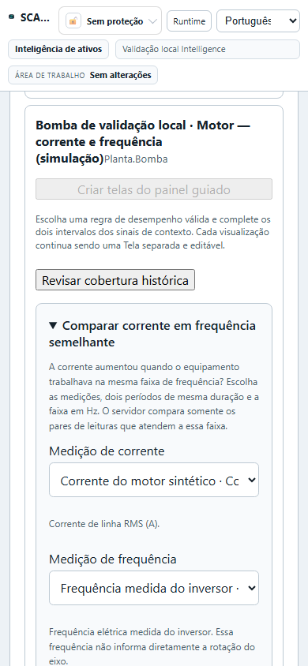

**Comparar 6 A con 5 A**

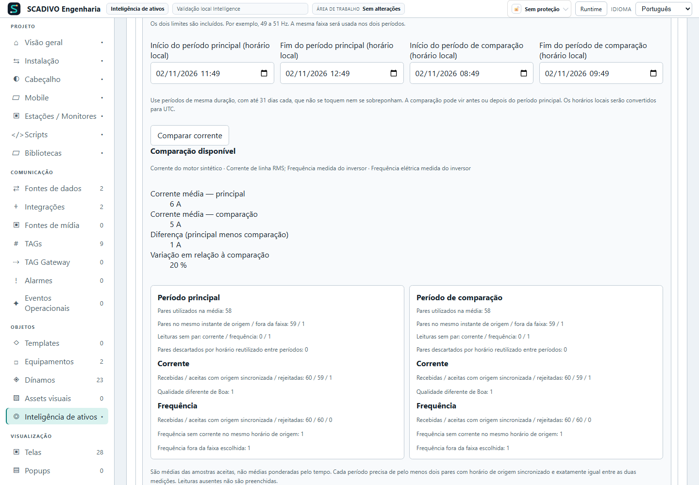

**Datos insuficientes no son cero**

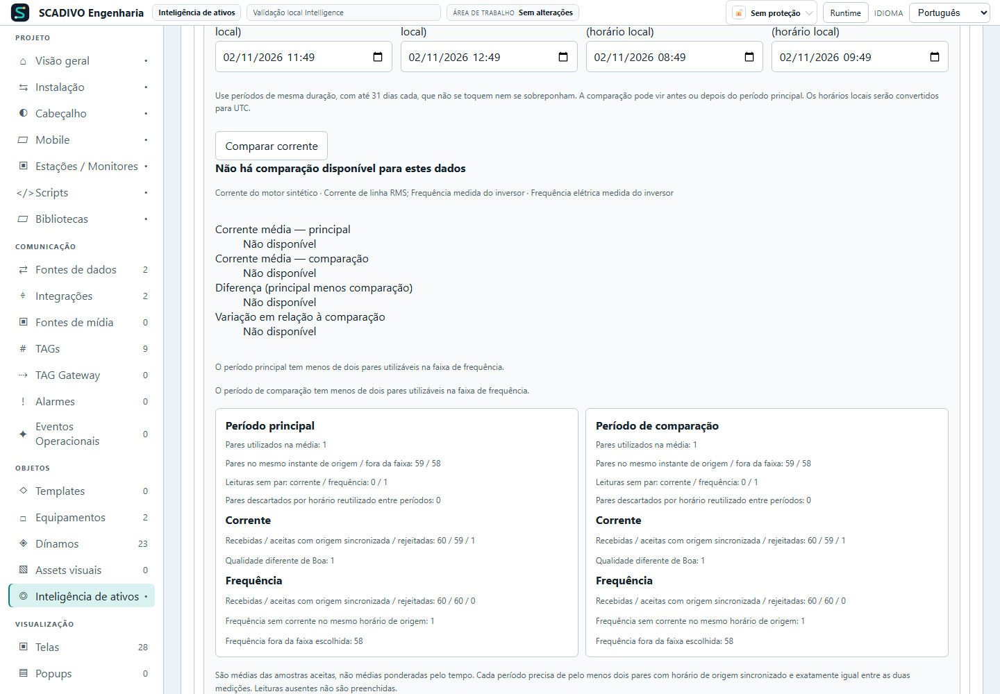

**Incluir la comparación en el generador de etapa**

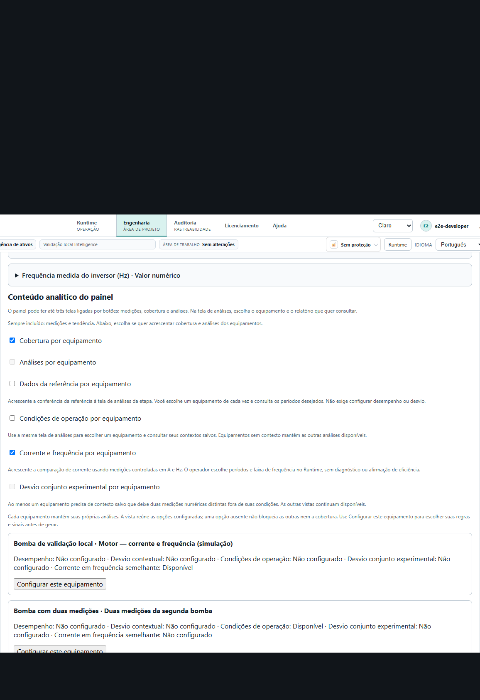

**Seleccionar el miembro en Runtime**

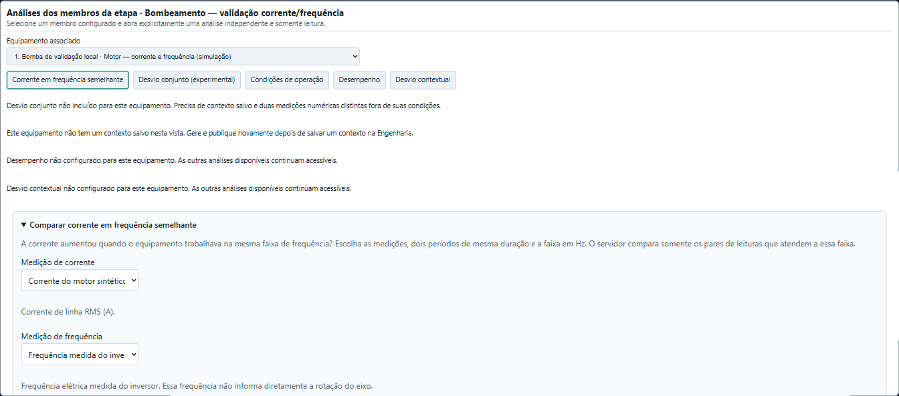

**Resultado por equipo**

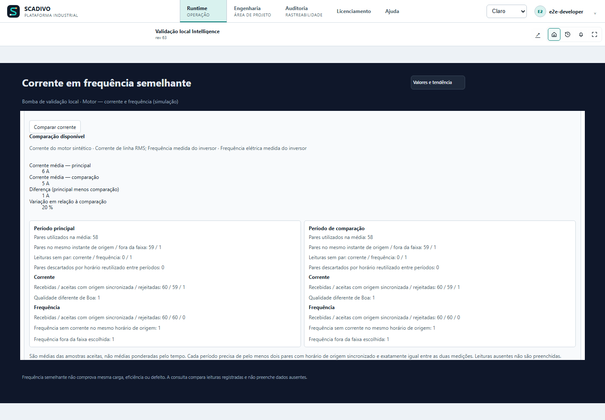

**Detalles estadísticos: interfaz real en portugués bajo prueba, con respuestas simuladas**

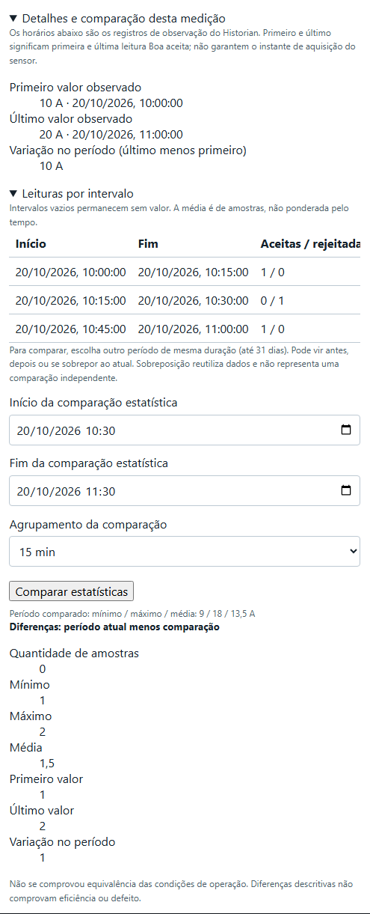

**Tasa neta: interfaz real con respuestas API simuladas, no prueba API/PostgreSQL**

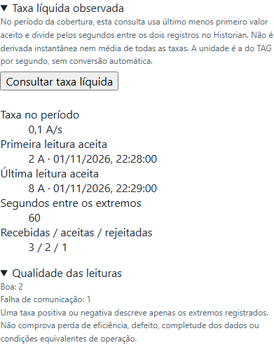

**Objetivo único: formulario real con API simulada, no prueba API/PostgreSQL**

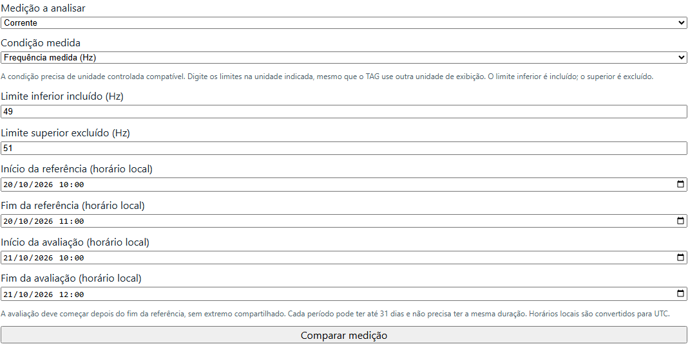

**Objetivo único: resultado y evidencia reales de interfaz con datos simulados**

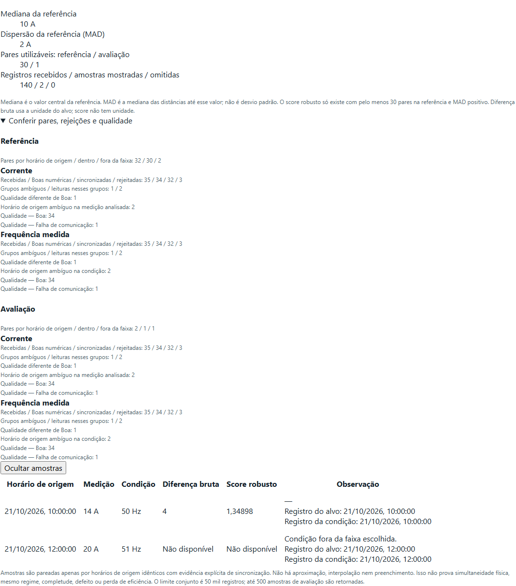

**Objetivo único en Runtime: interfaz real en inglés con API simulada, no prueba API/PostgreSQL**

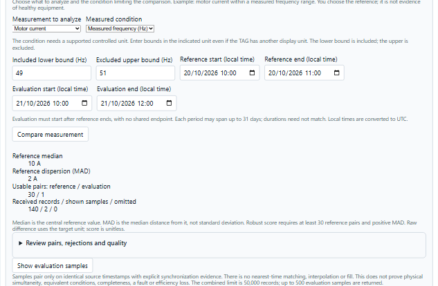

**Elegir medición bajo condición en el compositor de etapa (API simulada)**

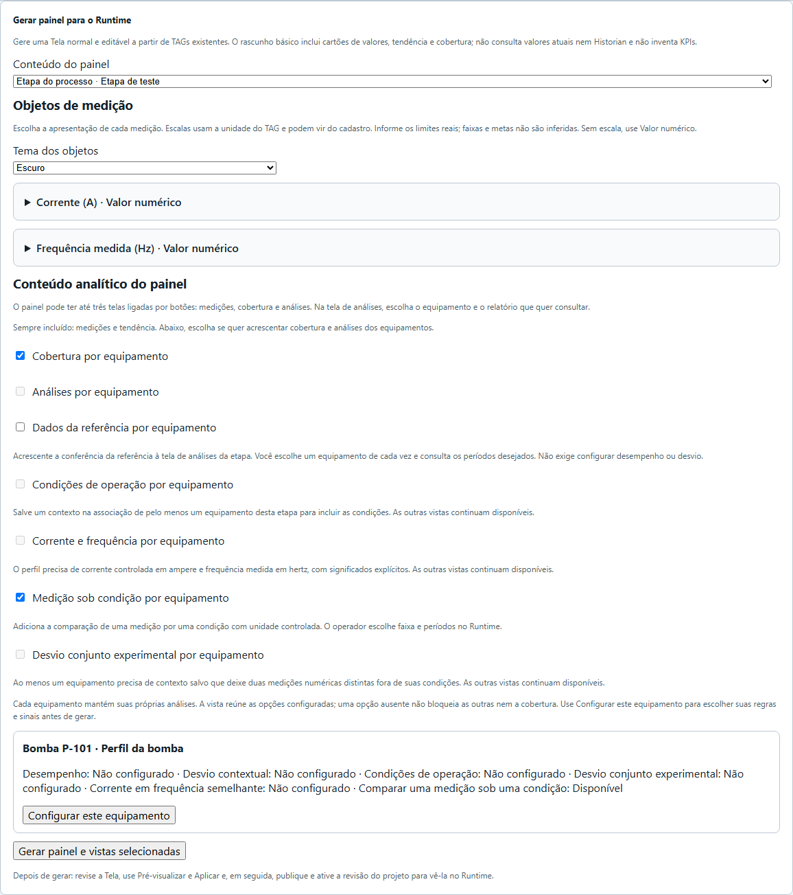

**Miembro sin condición compatible conserva otras vistas (API simulada)**

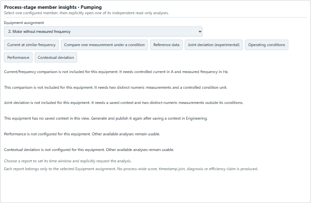

**Tasa real de 0 A/s para corriente constante de 6 A (API/PostgreSQL reales, datos sintéticos)**

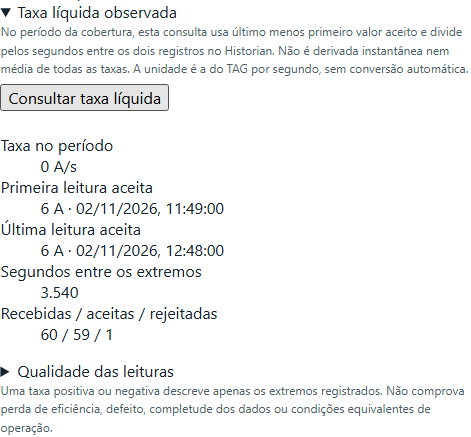

**Diferencia real entre medias de 6 A y 5 A (API/PostgreSQL reales, datos sintéticos)**

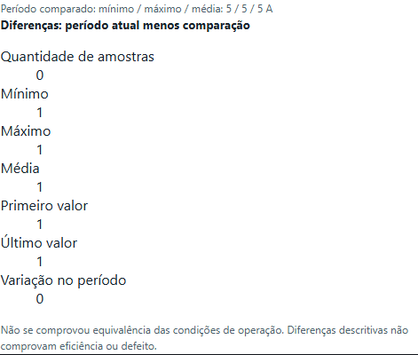

**Consulta de miembro de etapa en Runtime (API/PostgreSQL reales, datos sintéticos)**

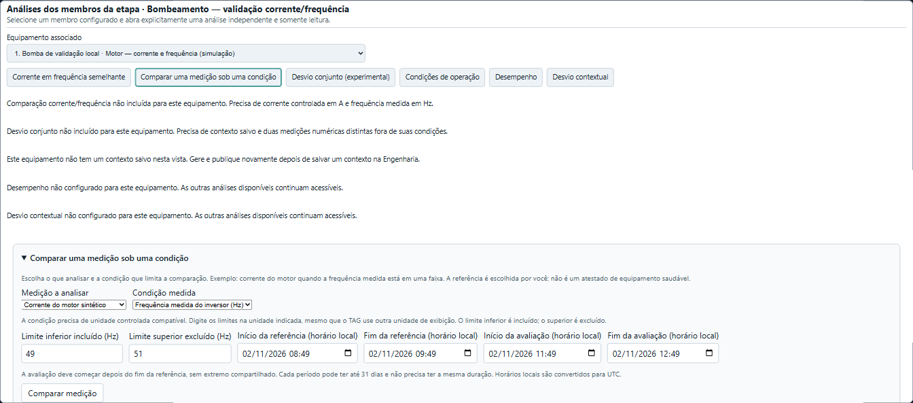

**Consulta conjunta real: datos sintéticos en API y PostgreSQL; diferencias y puntuaciones por medición.**

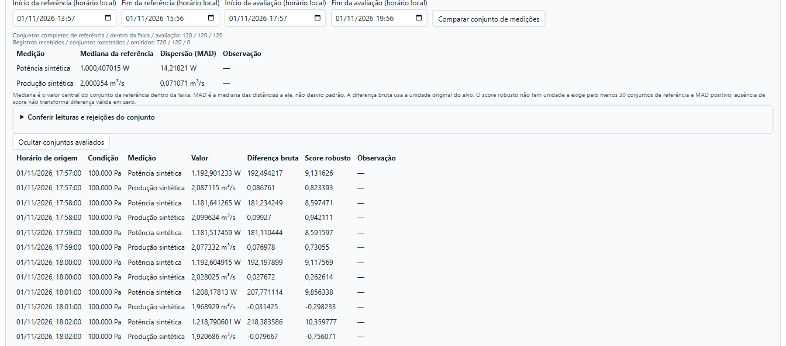

**Autor con edición de Ingeniería y gestión de un equipo, sin gestión global: compositor real en portugués, API/PostgreSQL y aplicación sintética.**

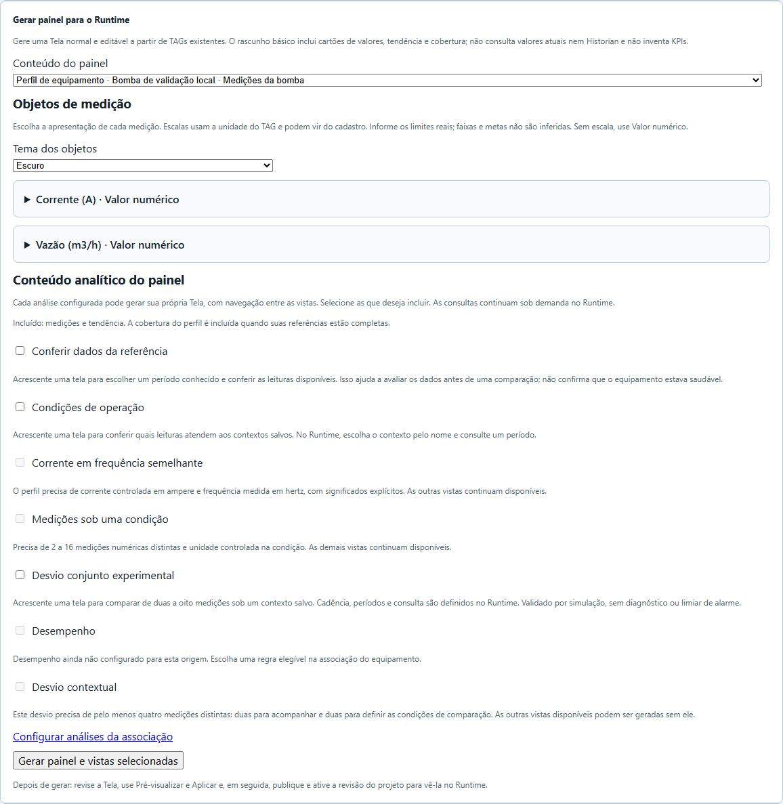

**Consulta de rendimiento bloqueada: próximos pasos en la interfaz real en portugués, sesión local y datos sintéticos.**

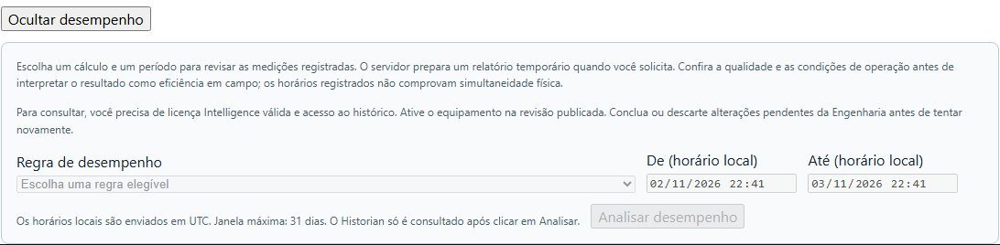

**Atajo del conjunto fijo y regreso al compositor principal en la interfaz real en portugués.**

[Abrir esta guía en Ayuda instalada](/help?topic=intelligence.analysis-guide)
