# Inteligência de Ativos e Processos

Este capítulo descreve os fluxos disponíveis hoje. Inteligência é opcional: a licença habilita a função, mas você configura os equipamentos, perfis e etapas que pretende analisar. Não é necessário aplicar análises a toda a planta.

**Ajuda contextual:** `/help?topic=intelligence.overview`.

## Comece por uma pergunta pequena

Imagine a Bomba 01. Você já recebe corrente e velocidade no SCADIVO e quer investigar se a corrente mudou quando a bomba trabalha em condições semelhantes. Comece por essa pergunta, sem tentar configurar toda a planta. Uma comparação pode orientar investigação; não comprova, sozinha, eficiência física ou defeito.

Os nomes usados no editor representam partes dessa tarefa:

| Nome | O que significa neste exemplo |
| --- | --- |
| TAG | A variável que fornece corrente ou velocidade. |
| Perfil de medição | A ficha que reúne os sinais escolhidos e o significado de cada um. |
| Associação | A ligação dessa ficha à Bomba 01 cadastrada como Equipamento. |
| Contexto operacional | A condição em que os dados devem ser comparados, como uma faixa de operação definida. |
| Etapa do processo | Um grupo organizado de associações, como os equipamentos do bombeamento. Não programa partidas. |
| Cobertura | A consulta que mostra quais dados utilizáveis existem no período. |

Siga este percurso e aprofunde cada parte nas seções abaixo:

1. Confira os TAGs existentes, suas unidades e os dados gravados do período. Não invente sensores ausentes.
2. Monte o perfil e associe-o à Bomba 01. Os seletores cuidam dos IDs internos.
3. Salve a configuração, escolha onde usar Intelligence, publique/ative a revisão e libere explicitamente o recurso para análise. Licença, configuração e execução autorizada são condições separadas.
4. Consulte primeiro a cobertura. Depois escolha apenas análises cujas exigências seus sinais atendem. Resultado indisponível precisa de verificação; não deve ser lido como zero.
5. Quando precisar de uma visualização para o operador, gere uma tela, revise no editor normal e siga a publicação/ativação. A tela abre no Runtime e as consultas dependem de solicitação explícita; gerar não consulta dados nem coloca a tela em operação automaticamente.

Você pode começar por um equipamento. Contextos e etapas entram quando forem úteis à pergunta. O detalhe sobre horários, papéis dos sinais e limites está adiante para consulta durante a configuração.

Use Onde deseja trabalhar? para ir direto a perfis, associações, contextos, etapas, painel ou equipamentos e locais habilitados para análise. Comece pelos perfis e associações; contexto e etapa só são necessários quando sua análise os utiliza. Navegar preserva o rascunho, sem salvar ou executar análise.

Pronto para consultar significa que o item foi ativado para a revisão atual. Se aparecer Reative antes de consultar, confira licença e permissões e selecione Ativar novamente. Isso pode ser necessário após reinício ou restauração da autorização. O cabeçalho mostra o nome da aplicação; a revisão ativa identifica a versão publicada em uso.

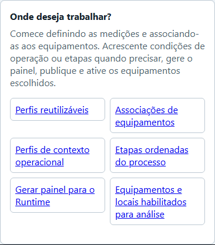

## 1. Começar pelo equipamento e pelos TAGs

Escolha o Equipamento já cadastrado e os TAGs de medições úteis, como corrente, tensão, pressão, vazão ou temperatura. Para cada TAG, confira o tipo de valor e a unidade. Qualidade informa a condição da leitura; timestamp é seu horário de origem. Historian é o histórico gravado, que precisa ter dados no período escolhido. Inclua o sinal pela pergunta que ele ajuda a responder, não apenas porque existe.

Para editar, sua conta precisa das permissões `EngineeringModify` e `AssetProcessIntelligenceManage`. A segunda deve ser concedida explicitamente para todos os recursos, ou para o equipamento/local que você vai configurar. Confira também a licença Intelligence. O nome do papel da conta não substitui a permissão efetiva.

## 2. Criar perfil de medição e associação

1. Abra Engineering > Inteligência de ativos e crie um Perfil de medição. Dê um nome que ajude a reconhecer o conjunto, como “Bomba de transferência”.
2. Adicione os TAGs que descrevem o equipamento. Para cada TAG, escreva o que ele mede, marque se é necessário para a análise e complete os detalhes semânticos solicitados. Confira a unidade e a referência real do TAG.
3. Salve a configuração no Working.
4. Na seção de associações, escolha o Equipamento existente e o perfil. Um equipamento pode usar mais de um perfil.
5. Revise referências ausentes e duplicadas antes de salvar e seguir o lifecycle normal do projeto.

O perfil organiza referências e significado dos sinais. As chaves internas são criadas pelo sistema; você não precisa inventar IDs ou códigos. O perfil não cria TAGs, não habilita captura Historian por si só e não comprova que os instrumentos estão calibrados.

## 3. Configurar contexto operacional

Corrente maior pode ser esperada se velocidade ou carga aumentou. Um contexto operacional explicita condições, como bomba ligada e velocidade em uma faixa definida, para selecionar evidências comparáveis. Ele não aprende automaticamente o modo de operação nem transforma correlação em diagnóstico. Defina limites com conhecimento do equipamento.

Escolha a associação do equipamento e dê ao contexto um nome que explique a condição, como “Bomba ligada em vazão normal”. Adicione ao menos uma condição usando um TAG do perfil associado. A chave interna do contexto é criada pelo sistema.

Para número, o intervalo inclui mínimo e máximo e usa a unidade atual do TAG. Para booleano, escolha True ou False. Para String ou Enum, use o valor exato, incluindo maiúsculas quando aplicável.

Todas as condições precisam corresponder a leituras com exatamente o mesmo instante UTC de origem. Leituras apenas próximas no tempo não bastam. Se outra edição alterar o contexto, atualize a tela e revise as condições antes de salvar.

## 4. Organizar etapas do processo

Use **Etapas ordenadas do processo** para montar a sequência que deseja acompanhar. Dê a cada etapa um nome legível, adicione as associações de equipamento/perfil e ajuste a ordem. A chave interna é criada pelo sistema. A etapa organiza membros, mas não infere por si só causalidade, balanço ou um KPI agregado do processo.

Salve a configuração no Working. Dados e análises de Runtime continuam sujeitos à revisão Active e às autorizações vigentes.

Para uma etapa, o mesmo gerador oferece Cobertura por equipamento e Análises por equipamento. A lista mostra o que já está configurado em cada membro. Use Configurar este equipamento para escolher as regras e sinais que faltam; depois volte ao gerador. Não é necessário configurar desvio em todos para gerar desempenho nos demais. As vistas selecionadas são Telas vinculadas e editáveis. No Runtime, escolha o equipamento e a análise, informe o período e consulte. Cada resultado continua pertencendo somente ao equipamento escolhido.

Para conferir uma referência no Runtime, escolha um perfil de equipamento no gerador e marque Conferir dados da referência. A opção acrescenta uma Tela própria; não depende de configurar desempenho ou desvio. Aplique o conjunto, salve, publique e ative. No Runtime ao vivo, abra Dados da referência, escolha um período conhecido e selecione Consultar referência. Você verá leituras recebidas, aceitas e rejeitadas por sinal e quantas puderam ser usadas juntas. Se quiser comparar outro período, marque Comparar com outro período e informe um intervalo posterior, sem sobreposição. Uma contagem alta não comprova que o equipamento estava saudável. Mudar os períodos limpa o resultado. Editor e reprodução histórica não executam esta consulta.

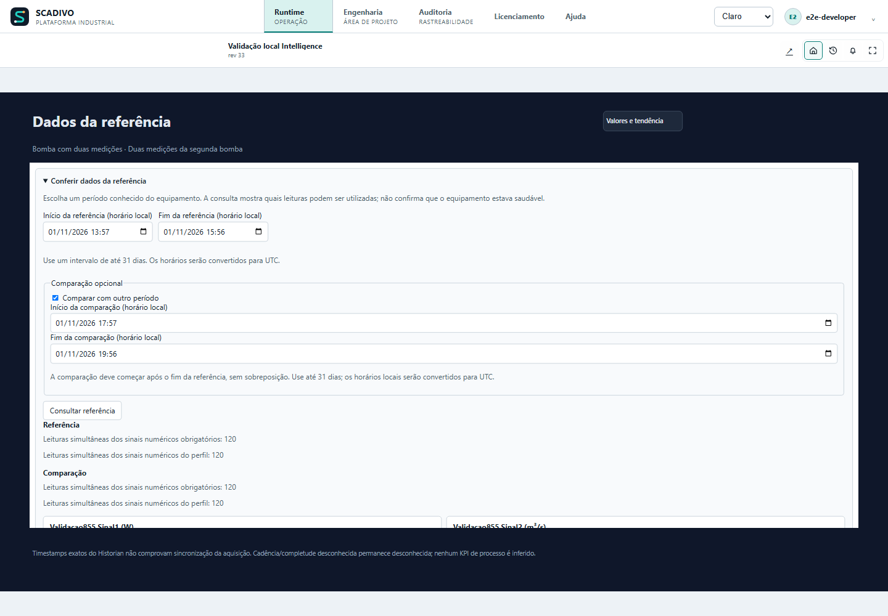

Para consultar referências dos equipamentos de uma etapa, escolha a etapa no gerador e marque Dados da referência por equipamento. Não é necessário configurar desempenho ou desvio. A opção usa a mesma Tela de análises da etapa; o conjunto continua com até três Telas. No Runtime, abra Análises por equipamento, escolha o equipamento e selecione Dados da referência. Informe os períodos e consulte. Ao escolher outro equipamento, o relatório anterior é fechado, a consulta em andamento é cancelada e o resultado é limpo; nada é consultado automaticamente para o novo equipamento.

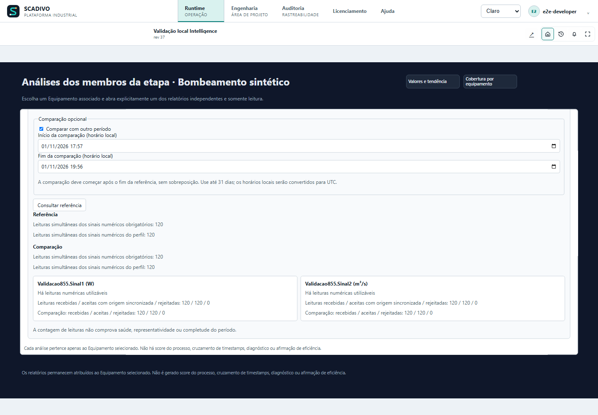

Para levar as condições de operação ao Runtime, primeiro salve um contexto na associação do equipamento. No gerador, escolha esse perfil e marque Condições de operação. A opção acrescenta uma Tela própria e funciona sem desempenho ou desvio configurados. Aplique o conjunto, salve, publique e ative. No Runtime ao vivo, abra Condições de operação, escolha Contexto salvo pelo nome, informe o início e o fim do período e clique em Consultar condições. Para comparar, use outro período posterior, sem sobreposição. O resultado mostra quantas leituras atendem a cada condição e quantas atendem a todas ao mesmo tempo. Por exemplo, uma condição de pressão entre 0 e 200 kPa pode selecionar leituras que uma faixa de 0 a 50 kPa exclui. Zero leituras compatíveis não significa equipamento saudável: significa que o período não fornece dados nas condições escolhidas. Trocar o contexto ou os períodos limpa o resultado anterior. Se o contexto mudar na Engenharia, gere e publique novamente a vista; ela não assume silenciosamente uma nova versão. Editor e reprodução histórica não executam a consulta.

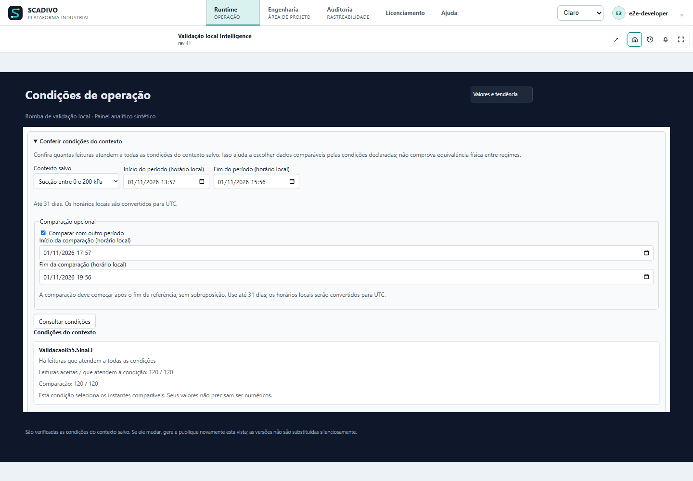

Para consultar condições nos equipamentos de uma etapa, escolha a etapa no gerador e marque Condições de operação por equipamento. Basta ter um contexto salvo em pelo menos uma associação da etapa; não é necessário configurar desempenho ou desvio. As condições usam a mesma Tela de análises, mantendo o conjunto com até três Telas. No Runtime, abra Análises por equipamento, escolha o equipamento, clique em Condições de operação e escolha Contexto salvo pelo nome. Informe os períodos e consulte. Somente os contextos daquele equipamento aparecem. Se ele não tiver contexto incluído, a página explica o que falta e mantém suas outras análises disponíveis. Ao trocar de equipamento ou análise, o relatório anterior é fechado, a leitura pendente é cancelada e o resultado é limpo. Nenhuma consulta começa automaticamente. Se alterar um contexto na Engenharia, gere e publique novamente a vista para usar a nova versão.

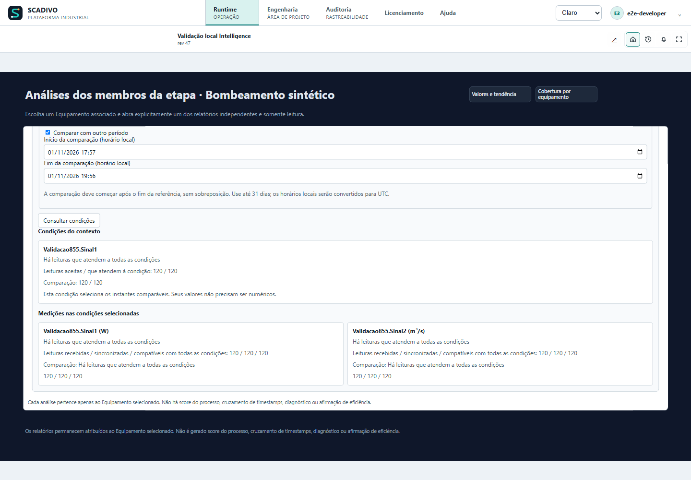

Para acompanhar o desvio conjunto no Runtime, escolha um perfil de equipamento no gerador e marque Desvio conjunto experimental. É preciso ter contexto salvo e pelo menos duas medições numéricas distintas fora das condições desse contexto. A opção acrescenta uma Tela própria, sem exigir desempenho ou desvio contextual. Aplique o conjunto, salve, publique e ative.

No Runtime ao vivo, abra Desvio conjunto (experimental), escolha Contexto salvo e marque de duas a oito medições pelo nome. Informe o intervalo real entre leituras em segundos: por exemplo, 60 para uma leitura por minuto. Escolha referência e avaliação, sem sobreposição, e clique em Calcular desvio conjunto. A consulta não começa ao abrir a Tela.

Confira primeiro quantos instantes completos sustentam a referência, quantos geraram score e quantos ficaram em aquecimento. Dados insuficientes não significam funcionamento normal: revise contexto, períodos e leituras. Nos resultados, abra Contribuições das medições para investigar quais variaram. O score descreve afastamento da referência, sem unidade física; um número maior não confirma defeito.

Esta análise é experimental, validada por simulação, sem previsão de vida útil ou limiar de alarme validado.

Trocar contexto, medições, cadência ou períodos limpa o resultado. Editor e reprodução histórica não calculam. Se mudar o contexto na Engenharia, gere e publique a vista novamente.

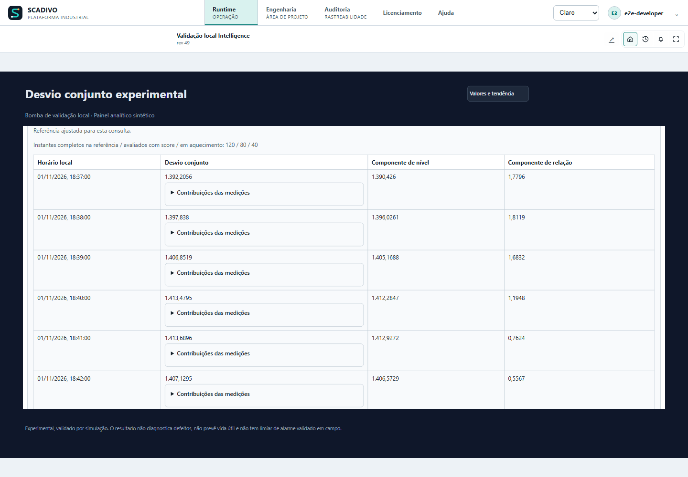

Para incluir o score nos equipamentos de uma etapa, escolha a etapa no gerador e marque Desvio conjunto experimental por equipamento. Basta que pelo menos uma associação tenha contexto salvo que deixe duas medições numéricas distintas fora de suas condições. Não precisa marcar desempenho, referência ou condições de operação. A opção usa a mesma Tela de análises, mantendo até três Telas no conjunto. Aplique, salve, publique e ative.

No Runtime, abra Análises por equipamento, escolha o equipamento e selecione Desvio conjunto (experimental). Escolha contexto e medições pelo nome; informe a cadência real e os períodos e solicite o cálculo. O resultado pertence somente ao equipamento escolhido. Se outro membro não tiver requisitos, a página explica a ausência e mantém as outras vistas disponíveis. Ao trocar equipamento ou análise, o formulário anterior é fechado, a leitura pendente é cancelada e o resultado é limpo; nada é consultado automaticamente. O score continua experimental, sem diagnóstico, vida útil ou limiar de alarme validado em campo.

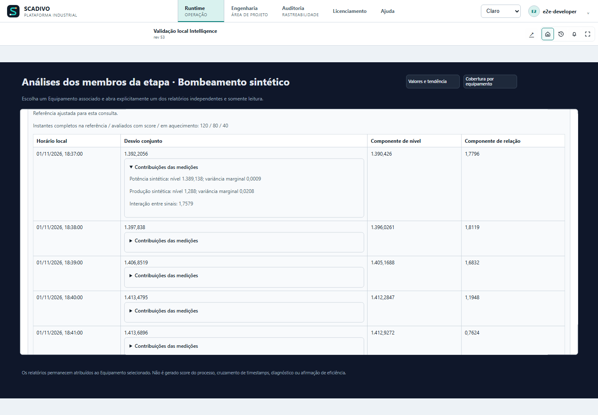

## 5. Consultar análises

Selecione o equipamento associado e escolha a análise disponível — como cobertura de perfil, desempenho ou desvio contextual. Defina o período e solicite a consulta explicitamente. Desvio contextual exige condições operacionais configuradas e evidência temporal suficiente. A análise é somente leitura; não altera TAG, não comanda equipamento e não substitui Alarmes.

Interprete o resultado junto com a cobertura, quality, timestamps e limitações de cada sinal. Ausência, quality ruim, falta de histórico ou desalinhamento temporal não significam zero, operação normal ou falha confirmada. As análises atuais não são diagnóstico de manutenção nem comprovação de eficiência física. Para membros de uma etapa, consulte um equipamento por vez; não some resultados independentes como um score do processo.

**Ajuda contextual:** `/help?topic=intelligence.process-stage-member-insights`.

## 6. Gerar rascunhos de telas

Salve primeiro as alterações pendentes da configuração da Intelligence. Na parte superior da página, localize **Gerar painel para o Runtime** e selecione em **Conteúdo do painel** um perfil de equipamento ou uma etapa do processo. A lista mostra os nomes cadastrados; você não precisa digitar IDs. O gerador básico precisa encontrar ao menos um TAG numérico resolvido. Se nada puder ser escolhido, complete o perfil, a associação ou a etapa e confira a licença e as permissões.

Clique em **Gerar rascunho do painel**. O SCADIVO abre uma Tela comum e editável no editor canônico, com cartões de valores, tendência e cobertura construídos a partir dos TAGs existentes. Isso é um rascunho: não consulta valores atuais nem Historian, não inventa KPIs e não publica a Tela.

No editor, confira nomes, unidades, dimensões, vínculos e legibilidade. Use **Pré-visualizar** e **Aplicar ao Workspace**; depois salve, publique e ative a revisão do projeto e configure/confira a navegação do Runtime. Só então a Tela poderá ser aberta pelos operadores. As ações guiadas especializadas ficam junto às análises correspondentes e podem pedir regras ou faixas adicionais.

Se o gerador criar Telas vinculadas, Pré-visualizar e Aplicar ao Workspace incluem todo o conjunto para preservar os destinos da navegação. Revise o conjunto antes de aplicar.

## 7. Problemas comuns

### Escolher os objetos e as análises do painel

Depois de escolher a origem, abra cada medição em **Objetos de medição**. Você pode usar valor numérico, gauge semicircular, anel, barra horizontal, régua vertical, faixas ou valor com meta. A escolha visual não muda o TAG nem o cálculo. O tema dos objetos pode ser claro, escuro ou de alto contraste.

Para um objeto com escala, confira mínimo e máximo na unidade do TAG. Se já houver escala válida no cadastro, ela será preenchida; caso contrário, informe os limites reais. Em Faixas, informe dois limites ordenados dentro da escala. Em Valor e meta, informe uma meta dentro dos limites. A geração fica bloqueada com intervalos incompletos ou inválidos. Você pode usar Valor numérico quando não dispõe de uma escala adequada.

Em **Conteúdo analítico do painel**, desempenho e desvio contextual ficam disponíveis quando suas seleções estiverem completas na associação. Use **Configurar análises da associação** para chegar aos controles existentes. Cada análise pode ser incluída independentemente. Ao gerar mais de uma vista, as Telas recebem botões de navegação entre si. Uma análise indisponível não impede gerar as outras vistas; confira o motivo antes de alterar o significado dos sinais.

Os painéis gerados usam um fundo escuro próprio para manter o contraste nos temas claro e escuro do sistema. Você pode alterá-lo em Fundo, no editor de Telas; confira também as cores dos textos e valores ao escolher outro fundo.

- **Recurso bloqueado:** confira licença, `EngineeringModify`, `AssetProcessIntelligenceManage` e escopo.
- **Perfil ou associação incompleta:** confira equipamento, perfil, TAGs e qualificadores obrigatórios.
- **Sem cobertura/histórico:** confirme se o TAG recebia amostras com quality e timestamps úteis e se a captura existia no período. Historian não preenche dados retroativamente.
- **Contexto sem correspondência:** revise as condições, a unidade, o intervalo e se as leituras têm o mesmo horário de origem.
- **Rascunho indisponível:** complete as seleções exigidas pelo tipo de tela e use o editor normal para corrigir o resultado.
- **Resultado diferente após edição:** salve a configuração correta, confira a revisão Active e faça uma nova consulta explícita.

**Ajuda relacionada:** `/help?topic=historian.overview`, `/help?topic=tags.quality`, `/help?topic=tags.timestamps`, `/help?topic=screens.overview`, `/help?topic=engineering.lifecycle`.

## Confira os dados antes de interpretar

Em Engenharia > Inteligência de ativos, localize a associação do equipamento. Em Conferir dados da referência, escolha início e fim de um período conhecido e clique em Consultar referência. Os horários são locais e convertidos para UTC. Cada período pode ter até 31 dias. Leituras aceitas têm a evidência de origem exigida; rejeições explicam por que outras leituras ficaram de fora. A contagem não comprova que o equipamento estava saudável.

Em Conferir condições do contexto, selecione um contexto salvo pelo nome e consulte o período. O SCADIVO usa a versão salva automaticamente. O resultado informa quantas leituras atendem a todas as condições no mesmo instante de origem. Zero leituras compatíveis pode significar condições não atendidas ou dados insuficientes; confira a explicação apresentada. Publique as alterações e ative o equipamento antes de consultar.

## Use o desvio conjunto experimental

Abra Desvio conjunto experimental na associação. Escolha o contexto salvo e de duas a oito medições numéricas; medições que definem as condições do contexto ficam fora da lista de alvos. Informe o intervalo real de aquisição em segundos, de 1 a 86.400. Não invente esse valor: ele descreve a frequência esperada das leituras. Escolha uma referência e um período posterior de avaliação, sem sobreposição, e clique em Calcular desvio conjunto.

O resultado mostra quantos instantes puderam ser avaliados e quantos ficaram em aquecimento. O desvio combina mudanças de nível e da relação entre sinais. Expanda Contribuições das medições para investigar a participação de cada sinal. Esses números não têm unidade física e não diagnosticam causa, falha ou vida útil. A função é experimental, validada somente por simulação e sem limiar de alarme validado em campo.

Use Cancelar consulta para interromper. Mudar período, contexto, sinais ou cadência descarta o resultado anterior; é preciso consultar novamente. Se a referência não puder ser ajustada, confira dados, qualidade, sincronização, contexto e variação dos sinais antes de ampliar períodos.

## Entenda as contagens e as condições

As análises são consultadas sob demanda: editar perfis ou ativar um escopo não inicia análise contínua. Na referência, leia os motivos ao lado de Não disponível. Um sinal obrigatório de texto, opção ou verdadeiro/falso não entra na coorte numérica obrigatória; a contagem dos sinais numéricos do perfil continua sendo apresentada separadamente. Contagem zero de um tipo não consultado não prova ausência de histórico.

Na consulta de contexto, veja primeiro Condições do contexto: leituras aceitas e quantas atenderam a cada condição. Uma condição de modo pode ser textual e ainda selecionar os instantes válidos para corrente ou vazão. Depois confira as medições nas condições selecionadas. Essas contagens não comprovam saúde ou eficiência.

## Compare dois períodos e cancele consultas

Nas consultas de referência e condições do contexto, marque Comparar com outro período se quiser conferir a evidência em duas janelas. Preencha o início e o fim da comparação. Cada janela pode ter até 31 dias, e o início da comparação deve ser estritamente posterior ao fim da referência: não use o mesmo instante nos dois limites. A consulta fica indisponível enquanto houver campos vazios, período invertido ou sobreposição.

Consulte e leia as contagens de cada período. A comparação de contagens não é, por si só, um indicador de eficiência. Desmarcar a comparação ou alterar qualquer limite remove o resultado anterior. Durante a leitura, use Cancelar consulta: uma resposta atrasada não deve reaparecer na tela. Para consultar novamente, confira os parâmetros e clique no botão de consulta.

<!-- installed-system-guides -->

## Intelligence: habilitar, pausar e resolver bloqueios

Escolha quais equipamentos analisar, prepare a configuração e ative o uso. Ter a licença não inicia análises automaticamente.

<!-- HELP-REVIEW-AFTER-PRODUCT-858-INTELLIGENCE: https://github.com/brunolrogerio-collab/EliteSCADA/issues/858; topic=intelligence.activation; fields=; status=WAITING_PRODUCT_IMPLEMENTATION_AND_VALIDATION -->

### Siga a sequência completa

Comece com um equipamento, como Bomba 01. Abra Engenharia > Inteligência de ativos. Você vai reunir as variáveis da bomba, dizer a qual equipamento pertencem e escolher onde usar a análise.

O perfil é a lista de sinais e seus significados. A associação liga esse perfil ao Equipamento cadastrado. Configure contextos e etapas somente quando fizerem sentido para sua pergunta. Depois salve, publique e ative a revisão do projeto.

Há ainda uma decisão separada: ativar explicitamente o recurso selecionado para permitir as análises. Criar o perfil, marcar uma caixa ou possuir a licença não faz essa ativação por você.

Use Onde deseja trabalhar? para ir direto a perfis, associações, contextos, etapas, painel ou equipamentos e locais habilitados para análise. Comece pelos perfis e associações; contexto e etapa só são necessários quando sua análise os utiliza. Navegar preserva o rascunho, sem salvar ou executar análise.

Pronto para consultar significa que o item foi ativado para a revisão atual. Se aparecer Reative antes de consultar, confira licença e permissões e selecione Ativar novamente. Isso pode ser necessário após reinício ou restauração da autorização. O cabeçalho mostra o nome da aplicação; a revisão ativa identifica a versão publicada em uso.

### Permissões e seleção de recursos

Sua conta precisa de permissão para editar a Engenharia e para gerenciar Intelligence nos equipamentos ou locais escolhidos. Na tela Segurança, essas permissões aparecem como EngineeringModify e AssetProcessIntelligenceManage. A segunda precisa de uma concessão explícita, global ou com alcance no recurso. O nome do papel, como Developer ou SystemAdmin, sozinho não comprova a concessão.

Para consultar resultados, também são necessários TrendUse e licença Intelligence. Se um controle estiver bloqueado, confira as capacidades efetivas da sessão nessa tela. Selecione os recursos pelos seletores; não é necessário decorar ou inventar IDs.

### Ativar apenas onde for útil

1. Em Escopos elegíveis, selecione apenas os equipamentos ou locais que deseja analisar. Escopo, aqui, é essa seleção de recursos.
2. Salve os escopos e a configuração preparada.
3. Publique e ative a revisão do projeto. Resolva alterações pendentes antes de liberar a execução.
4. Na linha do recurso, use Ativar e confira se a permissão de execução ficou armada, isto é, liberada para esse recurso.
5. Abra a consulta da associação, escolha o período e solicite a análise. A ativação permite consultar; não faz a consulta automaticamente.
6. Para interromper as análises, use Pausar. O trabalho pendente é cancelado, mas TAGs e histórico permanecem. Antes de retirar um recurso da seleção, pause-o.

### Ativo configurado não significa permissão armada

Se uma permissão foi revogada, o recurso pode continuar marcado como Ativo na configuração e, mesmo assim, estar impedido de executar. São duas informações diferentes: o que foi configurado e o que está autorizado agora.

Restaurar a concessão não reinicia o trabalho silenciosamente. Confira o estado e use Ativar novamente, inclusive após reinício quando a tela pedir. Isso exige uma decisão explícita do responsável. Verifique essa condição antes de investigar falta de dados no histórico gravado, chamado Historian.

### Exemplo de implantação pequena

Para Bomba 01, comece com corrente e velocidade se essas medições existirem. Escolha análises que aceitem esses sinais. Quando houver novas medições, você poderá ampliar o perfil e usar outras análises compatíveis.

Deixe pausados os recursos que não pretende usar. Não invente um sinal de vibração ausente. A seleção reduz o que está autorizado a executar, mas não garante um consumo fixo de processador ou memória.

[Abrir este guia na Ajuda instalada](/help?topic=intelligence.activation)

## Intelligence: significado dos sinais e unidades

Diga o que foi medido, não apenas como o TAG foi chamado.

### Por que o nome não basta

Antes de calcular, explique o que cada variável mede. Por exemplo, um TAG chamado Potência pode ser potência ativa, aparente ou um cálculo; Pressão pode medir a sucção, a descarga ou a diferença entre elas. O nome sozinho não permite escolher a fórmula correta.

No perfil, selecione o papel semântico pedido: é a opção que identifica o significado do sinal para a análise. Depois preencha os qualificadores exibidos, os detalhes que tornam essa escolha precisa. O texto de papel legado continua sendo uma descrição; não substitui essa seleção.

### Campos e escolhas

Use esta tabela quando surgir dúvida no perfil. Os seletores mostram as opções aceitas pelo catálogo atual. Escolha a que corresponde ao instrumento e ao processo, mesmo que outra opção liberasse um cálculo.

| Campo | Para que serve e como preencher | Exemplo | Limites |
| --- | --- | --- | --- |
| Obrigatório | Marca sinais cuja ausência compromete a cobertura pedida. Não transforme um sinal essencial em opcional apenas para obter resultado. | Corrente necessária à comparação |  |
| Papel semântico | Escolha o que o sinal representa para o cálculo, por exemplo qual grandeza e qual função na máquina. A análise usa essa opção controlada; não adivinha pelo nome do TAG. | Potência ativa de entrada, se medida |  |
| Base de corrente | Informe a base de corrente que o instrumento fornece e que o papel admite, como RMS quando apropriado. Se a etiqueta diz apenas corrente, confirme a medição antes de escolher. | Selecionar a opção documentada do instrumento |  |
| Tipo de sinal | Diferencia medição, referência e função exigida pelo papel. Um setpoint não comprova o valor medido. | Medição real quando a regra exigir |  |
| Referência de pressão | Diga qual pressão foi medida. A diferença entre saída e entrada é diferente da pressão de descarga sozinha; escolha a base exigida pelo papel e confirmada pelo instrumento. | Diferencial medido saída − entrada |  |
| Direção do fluxo | Diz em que sentido a vazão representa a transferência. Sentido oposto pode invalidar uma regra. | Bomba para processo, quando corresponder |  |
| Referência de frequência | Explica qual frequência o sinal representa conforme o catálogo; não confunda referência elétrica e velocidade física. | Conferir a origem do instrumento |  |
| TAG e unidade | Selecione o TAG real e confira sua unidade de engenharia controlada. Alterar apenas rótulo no perfil não converte os dados. Alguns cálculos exigem versões/unidades específicas do catálogo. | kW para potência, se esse for o dado real |  |

### Exemplo: não confundir proxy com eficiência

Suponha que a corrente da bomba aumentou enquanto a velocidade permaneceu igual. Isso pode orientar uma investigação, mas a corrente, sozinha, não calcula a eficiência física do motor. É um indicador substituto, também chamado proxy.

Outras regras podem usar potência elétrica de entrada, vazão e diferença de pressão. Elas só ficam disponíveis quando os sinais têm os papéis, unidades e alinhamento exigidos. Se faltar uma medição ou um detalhe necessário, leia o motivo da indisponibilidade; não preencha valores fictícios para liberar a regra.

[Abrir este guia na Ajuda instalada](/help?topic=intelligence.semantics)

## Intelligence: consultar resultados e montar dashboards

Comece conferindo os dados do período. Depois escolha um cálculo e, se precisar, gere uma tela para consultar no Runtime.

<!-- HELP-REVIEW-AFTER-PRODUCT-857-INTELLIGENCE: https://github.com/brunolrogerio-collab/EliteSCADA/issues/857; topic=intelligence.analysis-guide; fields=; status=WAITING_PRODUCT_IMPLEMENTATION_AND_VALIDATION -->

### Comece pela cobertura

Cobertura responde à primeira pergunta: há dados utilizáveis para esta análise? Com a associação salva e a execução autorizada, abra a consulta de cobertura do perfil. Escolha início e fim e solicite a consulta.

O formulário mostra horários locais; a consulta identifica também a janela UTC, a referência de tempo comum usada para comparar os dados. O fim deve ser posterior ao início.

Confira quais sinais obrigatórios têm dados, quantas amostras foram aceitas ou rejeitadas, a qualidade e o alinhamento dos horários. Só depois interprete mínimo, máximo ou média. Muitas amostras, por si só, não provam que não há lacunas nem que todos os sinais foram medidos juntos.

Em Agrupar leituras a cada, escolha 15 ou 30 minutos, 1 hora, 6 horas ou 24 horas. O padrão é 15 minutos. Essa escolha define os intervalos da consulta; não muda a captura do Historian nem preenche leituras ausentes. Alterar a opção limpa o resultado anterior; clique Analisar cobertura para consultar novamente.

### Comparar a corrente em uma faixa de frequência

Imagine que o motor consumia cerca de 5 A e agora consome 6 A. Antes de interpretar essa mudança, confira se as medições foram obtidas na faixa de frequência que você quer investigar. Esta consulta compara duas partes do histórico; ela não aprende um padrão nem diagnostica o motor.

1. Em Engenharia > Inteligência de ativos, encontre o equipamento e seu perfil em Associações. Abra Comparar corrente em frequência semelhante.
2. Escolha a medição de corrente e a frequência medida. O significado fica escrito também abaixo de cada seletor. Frequência elétrica do inversor não é rotação do eixo. RMS indica o valor eficaz da corrente; linha, fase e barramento CC são medições diferentes. Escolha a que realmente existe na sua instalação.
3. Informe uma faixa em Hz, como 49 a 51. Os limites são incluídos e a mesma faixa vale para os dois períodos. Hz significa ciclos por segundo; não digite rpm como se fosse Hz.
4. Escolha o período principal e o período de comparação, ambos em horário local. Use a mesma duração, até 31 dias cada. Eles não podem se sobrepor nem compartilhar um extremo. Por exemplo: principal das 10h às 11h do dia 22 e comparação das 10h às 11h do dia 20. A comparação pode ser anterior ou posterior.
5. Clique Comparar corrente. Abrir o painel e alterar campos não consulta o histórico. Cancelar consulta interrompe a solicitação; mudar uma escolha retira o resultado anterior.
6. Leia as duas médias, a diferença e a variação percentual. Com principal de 6 A e comparação de 5 A, o exemplo mostra +1 A e +20%. O sinal vem de principal menos comparação; inverter os períodos muda a referência.
7. Confira também os pares aproveitados, os que ficaram fora da faixa e as leituras rejeitadas. Se houver menos de dois pares utilizáveis em algum período, o resultado fica indisponível. Se a média de comparação for zero, a diferença pode existir, mas o percentual fica indisponível.

Pré-requisitos: salve a associação, publique/ative a revisão, ative o equipamento para análise e tenha licença e permissões de tendência/leitura dos dois TAGs. Os TAGs precisam existir na fonte ativa do Runtime, além de estarem cadastrados no perfil. Se faltarem opções, revise o significado e a unidade controlada no cadastro. Este método aceita o catálogo semântico 1: corrente elétrica com tipo explícito e unidade controlada ampere; frequência com saída medida, referência explícita e unidade controlada hertz, também do catálogo de unidades 1. Não basta escrever A/Hz no campo livre. Setpoint, rpm e versões de catálogo incompatíveis não são convertidos por suposição.

O servidor usa apenas leituras numéricas de qualidade Boa, com horário de origem sincronizado e exatamente igual entre corrente e frequência. Não aproxima horários nem preenche lacunas. As médias são de amostras, não ponderadas pelo tempo; o limite conjunto é 50.000 leituras brutas. Frequência semelhante não comprova mesma carga, regime de processo, eficiência ou defeito. Cadência, completude e simultaneidade física não estão comprovadas. Para o operador, use o gerador de painel: selecione o perfil e marque Corrente em frequência semelhante. Para uma etapa, marque Corrente e frequência por equipamento. Essa escolha é independente de desempenho, contexto e desvio conjunto; não exige sensores que você não tem. Gere os rascunhos, confira as telas no editor, valide/aplique ao Working, salve, publique e ative a revisão. Gerar não consulta o histórico. No Runtime ao vivo, abra a vista, escolha as medições, períodos e faixa e solicite a consulta. Na etapa, escolha primeiro o equipamento e depois Corrente em frequência semelhante; o resultado pertence apenas ao membro selecionado. Membros sem corrente/frequência compatíveis mantêm as outras vistas e mostram essa comparação desabilitada. Trocar membro, período ou contexto remove o resultado anterior. Editor e reprodução histórica não executam essa consulta. Após reiniciar o servidor ou uma revogação, confira a ativação e reative explicitamente se solicitado; a tela salva não reabre a autorização de execução.

| Campo | Para que serve e como preencher | Exemplo | Limites |
| --- | --- | --- | --- |
| Medição de corrente | Escolha por nome a corrente do perfil. Confira se é corrente eficaz de linha, de fase ou do barramento CC. A unidade da consulta é ampere. | Corrente do motor · linha RMS (A) | Catálogo 1; unidade A; tipo de corrente explícito. |
| Medição de frequência | Escolha a frequência realmente medida. O painel distingue saída elétrica do inversor e rotação do eixo; um comando de frequência não é aceito. | Frequência elétrica medida (Hz) | Catálogo 1; saída medida; Hz; referência explícita. |
| Frequência mínima (Hz) | Menor frequência que deve entrar na média, em Hz. Inclui valores iguais a este limite. Informe explicitamente; não há faixa inferida. | 49 | Finita; menor ou igual à máxima. |
| Frequência máxima (Hz) | Maior frequência aceita, em Hz. Deve ser maior ou igual à mínima. É permitido usar os dois limites iguais para uma frequência exata registrada. | 51 | Finita; maior ou igual à mínima. |
| Período principal | Início e fim do conjunto que você quer avaliar agora. O horário local é convertido para UTC; a duração deve ser positiva e não superar 31 dias. | 22/10 10:00–11:00 | Duração positiva; máximo de 31 dias. |
| Período de comparação | Início e fim da base de comparação. Use duração igual ao principal, sem sobreposição ou extremos compartilhados. Pode vir antes ou depois. | 20/10 10:00–11:00 | Mesma duração; sem contato ou sobreposição. |
| Comparar / cancelar | Comparar consulta o servidor. Cancelar descarta a solicitação em andamento. Uma resposta antiga não substitui escolhas mais recentes. | Comparar corrente | Solicitação explícita; sem cálculo automático. |
| Resultado e evidências | Confira médias em A, diferença principal menos comparação, percentual e contagens. Não disponível não significa zero; leia os motivos e a qualidade. | 6 A; 5 A; +1 A; +20% | Métricas indisponíveis não viram zero. |

### Desempenho: escolha uma regra elegível

Em Desempenho, escolha a regra de cálculo do catálogo. Se uma opção estiver desabilitada, leia qual sinal, significado ou unidade está faltando. Escolher outra grandeza apenas para obter um número mudaria a pergunta.

Preencha De/Até e consulte. Leia o estado, a unidade, o período efetivo e as limitações junto do resultado. Indisponível não é zero. Um indicador substituto, como uma comparação de corrente, não deve ser apresentado como eficiência física.

Se mudar a associação, a revisão ou os parâmetros, faça outra consulta. O resultado anterior pertence às escolhas anteriores.

### Dois tipos de contexto, com limites diferentes

Contexto descreve uma condição de operação para comparar situações semelhantes. Por exemplo, analisar a bomba numa faixa de vazão pode ser mais útil que misturar todas as condições. Existem duas configurações diferentes:

No perfil operacional salvo, o intervalo numérico inclui os dois limites, na unidade de engenharia atual. Os sinais precisam de evidência com o mesmo timestamp UTC de origem exato. Leituras apenas próximas no tempo não atendem esse requisito.

No gerador de tela de desvio contextual, escolha 2 a 8 sinais-alvo e dois sinais numéricos de contexto. Os dois contextos devem ser distintos entre si e dos alvos: são pelo menos quatro sinais numéricos utilizáveis. Digite as faixas na unidade indicada ao lado do campo. Por exemplo, para um TAG em kPa, informe 0 e 500 kPa; o SCADIVO converte internamente para 0 e 500000 Pa. O mínimo entra na comparação e o máximo não: mínimo ≤ leitura < máximo. Ao mudar o sinal de contexto, os limites são limpos para você informar a faixa correta. Sem quatro medições distintas, este desvio não fica disponível; isso não impede gerar cobertura ou desempenho quando seus próprios requisitos estiverem atendidos.

Mesmo quando a unidade é a mesma, confira a comparação: o perfil operacional inclui o máximo; a tela de desvio contextual não. Não copie uma faixa sem revisar essa diferença.

### Gere a tela e confira a cadeia completa

1. Salve a configuração atual. No bloco Gerar painel para o Runtime, escolha um perfil de equipamento ou uma etapa do processo em Conteúdo do painel.
2. Selecione Gerar rascunho do painel. O botão fica bloqueado se a configuração ainda não foi salva, faltar licença ou permissão, ou se a origem não tiver um TAG numérico válido.
3. No editor de Telas, confira título, dimensões, objetos, vínculos e legibilidade. Quando houver Telas vinculadas geradas juntas, Pré-visualizar e Aplicar ao Workspace incluem todas elas para preservar a navegação. Revise o conjunto antes de aplicar.
4. Salve a revisão, publique e ative. Configure ou confira a navegação e abra a Tela no Runtime.
5. No objeto de análise, configure o período e solicite a consulta. Confira a janela e o resultado. Uma Tela de etapa reúne seus equipamentos; isso não cria um indicador agregado nem demonstra que um equipamento causou o resultado de outro.

Para etapas, selecione Cobertura por equipamento e/ou Análises por equipamento no gerador. A lista indica o que está configurado; Configurar este equipamento leva às regras e sinais daquele membro. No Runtime, escolha um equipamento antes da análise. Opções não configuradas ficam indisponíveis e explicadas, sem impedir as outras.

Para conferir uma referência no Runtime, escolha um perfil de equipamento no gerador e marque Conferir dados da referência. A opção acrescenta uma Tela própria; não depende de configurar desempenho ou desvio. Aplique o conjunto, salve, publique e ative. No Runtime ao vivo, abra Dados da referência, escolha um período conhecido e selecione Consultar referência. Você verá leituras recebidas, aceitas e rejeitadas por sinal e quantas puderam ser usadas juntas. Se quiser comparar outro período, marque Comparar com outro período e informe um intervalo posterior, sem sobreposição. Uma contagem alta não comprova que o equipamento estava saudável. Mudar os períodos limpa o resultado. Editor e reprodução histórica não executam esta consulta.

Para consultar referências dos equipamentos de uma etapa, escolha a etapa no gerador e marque Dados da referência por equipamento. Não é necessário configurar desempenho ou desvio. A opção usa a mesma Tela de análises da etapa; o conjunto continua com até três Telas. No Runtime, abra Análises por equipamento, escolha o equipamento e selecione Dados da referência. Informe os períodos e consulte. Ao escolher outro equipamento, o relatório anterior é fechado, a consulta em andamento é cancelada e o resultado é limpo; nada é consultado automaticamente para o novo equipamento.

Para levar as condições de operação ao Runtime, primeiro salve um contexto na associação do equipamento. No gerador, escolha esse perfil e marque Condições de operação. A opção acrescenta uma Tela própria e funciona sem desempenho ou desvio configurados. Aplique o conjunto, salve, publique e ative. No Runtime ao vivo, abra Condições de operação, escolha Contexto salvo pelo nome, informe o início e o fim do período e clique em Consultar condições. Para comparar, use outro período posterior, sem sobreposição. O resultado mostra quantas leituras atendem a cada condição e quantas atendem a todas ao mesmo tempo. Por exemplo, uma condição de pressão entre 0 e 200 kPa pode selecionar leituras que uma faixa de 0 a 50 kPa exclui. Zero leituras compatíveis não significa equipamento saudável: significa que o período não fornece dados nas condições escolhidas. Trocar o contexto ou os períodos limpa o resultado anterior. Se o contexto mudar na Engenharia, gere e publique novamente a vista; ela não assume silenciosamente uma nova versão. Editor e reprodução histórica não executam a consulta.

Para consultar condições nos equipamentos de uma etapa, escolha a etapa no gerador e marque Condições de operação por equipamento. Basta ter um contexto salvo em pelo menos uma associação da etapa; não é necessário configurar desempenho ou desvio. As condições usam a mesma Tela de análises, mantendo o conjunto com até três Telas. No Runtime, abra Análises por equipamento, escolha o equipamento, clique em Condições de operação e escolha Contexto salvo pelo nome. Informe os períodos e consulte. Somente os contextos daquele equipamento aparecem. Se ele não tiver contexto incluído, a página explica o que falta e mantém suas outras análises disponíveis. Ao trocar de equipamento ou análise, o relatório anterior é fechado, a leitura pendente é cancelada e o resultado é limpo. Nenhuma consulta começa automaticamente. Se alterar um contexto na Engenharia, gere e publique novamente a vista para usar a nova versão.

Para acompanhar o desvio conjunto no Runtime, escolha um perfil de equipamento no gerador e marque Desvio conjunto experimental. É preciso ter contexto salvo e pelo menos duas medições numéricas distintas fora das condições desse contexto. A opção acrescenta uma Tela própria, sem exigir desempenho ou desvio contextual. Aplique o conjunto, salve, publique e ative.

No Runtime ao vivo, abra Desvio conjunto (experimental), escolha Contexto salvo e marque de duas a oito medições pelo nome. Informe o intervalo real entre leituras em segundos: por exemplo, 60 para uma leitura por minuto. Escolha referência e avaliação, sem sobreposição, e clique em Calcular desvio conjunto. A consulta não começa ao abrir a Tela.

Confira primeiro quantos instantes completos sustentam a referência, quantos geraram score e quantos ficaram em aquecimento. Dados insuficientes não significam funcionamento normal: revise contexto, períodos e leituras. Nos resultados, abra Contribuições das medições para investigar quais variaram. O score descreve afastamento da referência, sem unidade física; um número maior não confirma defeito.

Esta análise é experimental, validada por simulação, sem previsão de vida útil ou limiar de alarme validado.

Trocar contexto, medições, cadência ou períodos limpa o resultado. Editor e reprodução histórica não calculam. Se mudar o contexto na Engenharia, gere e publique a vista novamente.

Para incluir o score nos equipamentos de uma etapa, escolha a etapa no gerador e marque Desvio conjunto experimental por equipamento. Basta que pelo menos uma associação tenha contexto salvo que deixe duas medições numéricas distintas fora de suas condições. Não precisa marcar desempenho, referência ou condições de operação. A opção usa a mesma Tela de análises, mantendo até três Telas no conjunto. Aplique, salve, publique e ative.

No Runtime, abra Análises por equipamento, escolha o equipamento e selecione Desvio conjunto (experimental). Escolha contexto e medições pelo nome; informe a cadência real e os períodos e solicite o cálculo. O resultado pertence somente ao equipamento escolhido. Se outro membro não tiver requisitos, a página explica a ausência e mantém as outras vistas disponíveis. Ao trocar equipamento ou análise, o formulário anterior é fechado, a leitura pendente é cancelada e o resultado é limpo; nada é consultado automaticamente. O score continua experimental, sem diagnóstico, vida útil ou limiar de alarme validado em campo.

### Roteiro para investigar resultado vazio

Se não há resultado, procure a primeira condição que falta:

Confira licença e permissões; depois, a seleção salva do recurso e a permissão de execução armada. Confira se o projeto e a revisão ativos são os esperados. Em seguida, revise associação, TAGs e período.

Se esses itens estão corretos, examine a captura no Historian, a qualidade dos dados, os papéis e unidades dos sinais e as exigências de alinhamento e contexto. Corrija a condição comprovadamente ausente e consulte de novo.

Não mude o significado de um sinal nem amplie limites só para fazer aparecer um resultado. As análises ajudam a investigar. Elas não confirmam defeito nem antecipam falhas com validade de campo ainda não demonstrada.

#### Exemplo real: corrente e frequência

Interface real em português, com dados sintéticos de validação. O exemplo não representa um diagnóstico de campo.

**Escolher as medições no celular**

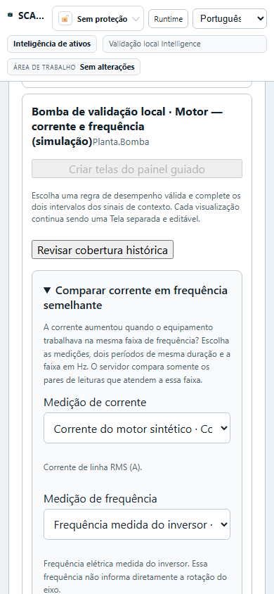

**Comparar 6 A com 5 A**

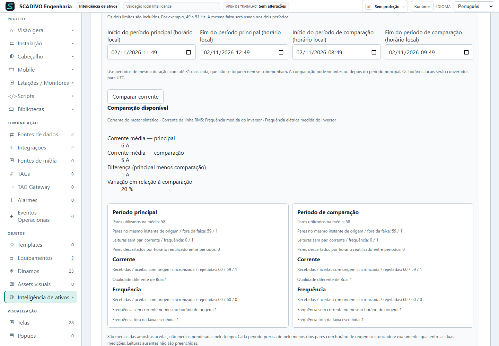

**Dados insuficientes não são zero**

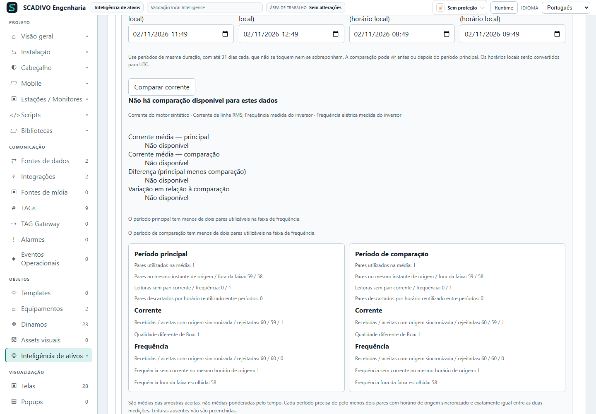

**Incluir a comparação no gerador da etapa**

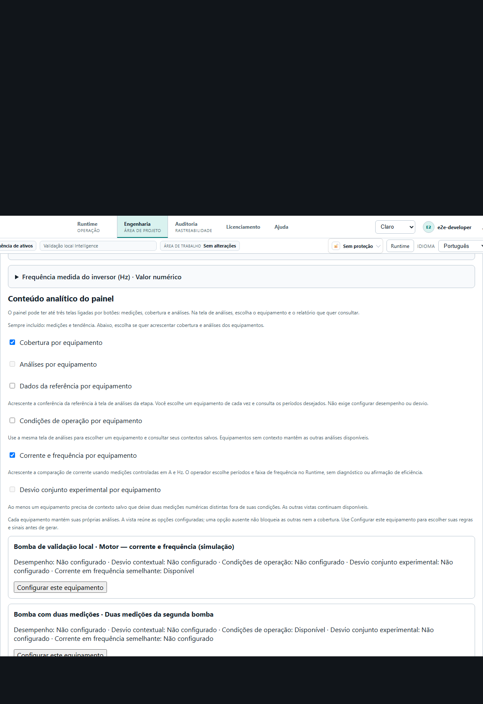

**Selecionar o membro no Runtime**

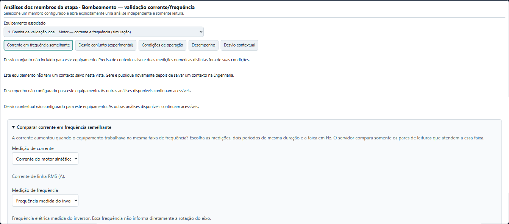

**Resultado por equipamento**

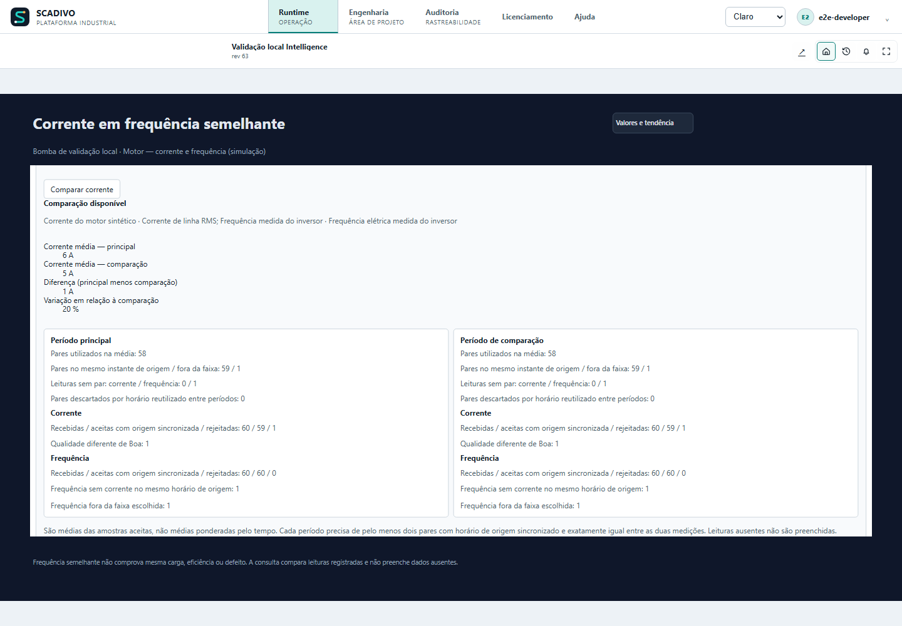

[Abrir este guia na Ajuda instalada](/help?topic=intelligence.analysis-guide)
